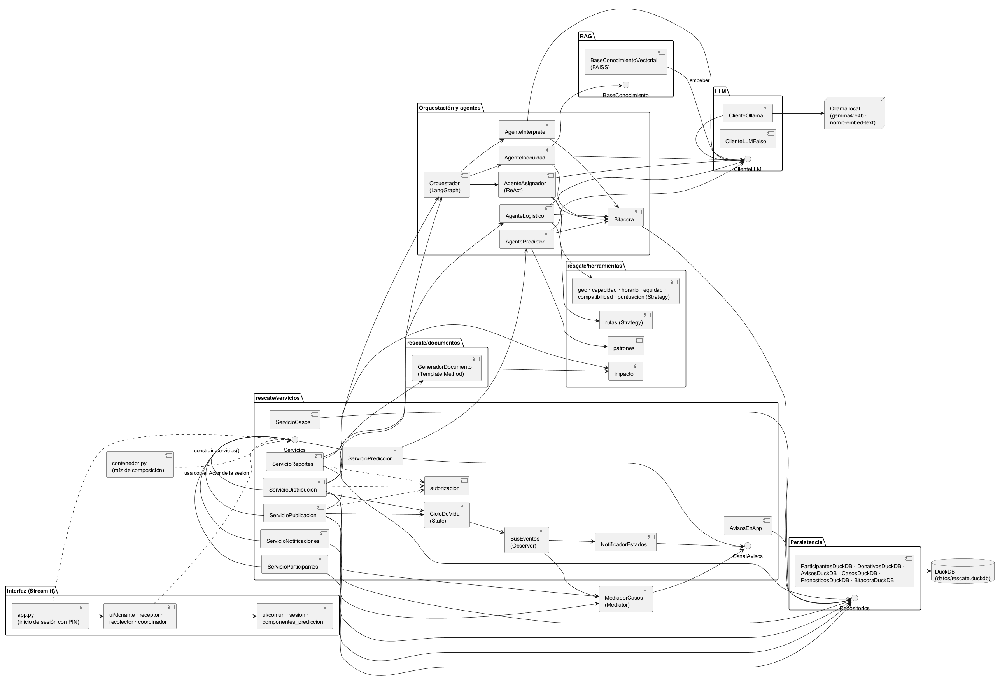
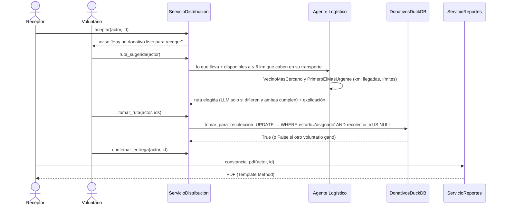
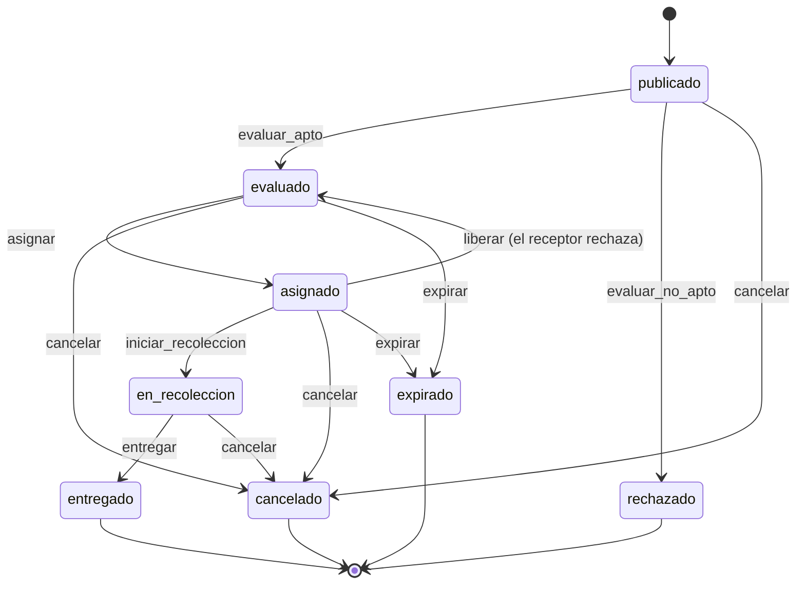

# Arquitectura

Cómo está construido Rescate Alimentario por dentro en la entrega final: capas, recorrido de una
publicación y de una recolección, ciclo de vida, eventos y mediador, patrones con su archivo y
cómo extenderlos, decisiones de seguridad y las fuentes de los factores de impacto. Los
diagramas UML 2.5 están en [uml/](uml/README.md).



## Capas

```text
app.py  inicio de sesión con PIN → Actor en st.session_state; página según actor.rol
  └─ ui/<rol>.py  mostrar(servicios: Servicios, actor: Actor)
       └─ rescate/servicios/  Servicios (dataclass sin lógica que agrupa los servicios)
            ├─ ServicioParticipantes   alta, edición, baja, PIN e inicio de sesión  ┐ salen del antiguo
            ├─ ServicioPublicacion     publicar, aclarar, cancelar                  │ ServicioDonativos
            ├─ ServicioDistribucion    asignar, aceptar, rechazar, recolectar,      │ (SRP)
            │                          entregar, vencer, ruta                       ┘
            ├─ ServicioReportes        consultas, historial, bitácora, tablero, PDF
            ├─ ServicioNotificaciones  avisos por participante
            ├─ ServicioCasos           bandeja del coordinador
            ├─ ServicioPrediccion      pronósticos y pre-reserva
            ├─ CicloDeVida             transiciones (State) + historial + BusEventos
            ├─ autorizacion.py         exigir_rol, participante_del_actor
            └─ BusEventos ──► NotificadorEstados (Observer) ──► CanalAvisos
                          └─► MediadorCasos (Mediator) ◄── señales de Publicación y Distribución
rescate/orquestador.py   LangGraph: interpretar → evaluar → asignar
rescate/agentes/         Intérprete · Inocuidad · Asignador (ReAct) · Logístico · Predictor
rescate/herramientas/    geo · capacidad · horario · equidad · compatibilidad · puntuacion
                         · rutas · impacto · patrones
rescate/documentos/      GeneradorDocumento (Template Method) → ConstanciaEntrega, ReporteImpacto
rescate/rag/             BaseConocimiento → FAISS sobre la NOM-251 y los criterios CI-01 a CI-07
rescate/llm/             ClienteLLM → ClienteOllama, ClienteLLMFalso
rescate/persistencia/    repositorios DuckDB (participantes, donativos, bitácora, avisos, casos, pronósticos)
rescate/contenedor.py    construir_servicios(): único lugar donde se conectan las piezas
```

## Recorrido de una publicación

```mermaid
sequenceDiagram
    actor D as Donante
    participant SP as ServicioPublicacion
    participant O as Orquestador
    participant I as Intérprete
    participant S as Inocuidad
    participant A as Asignador (ReAct)
    participant CV as CicloDeVida
    participant B as BusEventos

    D->>SP: publicar(actor, "Tengo 2 charolas de pollo en mole")
    SP->>SP: valida el Actor contra la base; candado (cola por orden de llegada)
    SP->>O: procesar(solicitud, receptores)
    O->>I: ejecutar (texto limpio y delimitado como dato)
    I-->>O: incompleto + pregunta
    SP-->>D: "¿A qué hora lo preparaste y cómo lo guardaste?"
    D->>SP: publicar(actor, texto + aclaración, mismo id)
    O->>I: ejecutar → alimentos; kg y horas calculados por código
    O->>S: reglas CI-01..CI-07 → RAG NOM-251 → LLM (solo endurece)
    S-->>O: apto con condiciones + citas comprobadas
    O->>A: ciclo pensamiento → acción → observación (herramientas)
    A-->>O: receptor validado (compatible, top 3, con ventaja)
    SP->>CV: registrar_publicacion · evaluar_apto · asignar
    CV->>B: EventoDonativo("asignar")
    B-->>D: avisos al donante y al receptor (NotificadorEstados)
```

1. **Intérprete.** Limpia el texto, detecta intentos de manipulación y lo pasa al LLM entre `<texto_donante>` como dato. Convierte la frase en alimentos con `InterpretacionLLM`; el código corrige el tipo, estima los kilos, convierte "hace una hora" y calcula el límite de recogida. La conservación que diga el LLM se valida contra `detectar_conservacion()` sobre el texto confiable. Si a un perecedero le falta la hora o la conservación, pregunta (máximo 2 aclaraciones).
2. **Inocuidad.** Cadena de 7 reglas; si dicen no apto, el LLM no se consulta. Si pasan, busca 4 fragmentos en la NOM-251, consulta al LLM y se queda con el dictamen más estricto. Las citas que no salieron de un fragmento recuperado se descartan. En alimentos de bajo riesgo, endurecer exige fundamento; los dictámenes dudosos se marcan con `requiere_revision` y abren un caso.
3. **Asignador.** Filtra con `evaluar_compatibilidad` (tipos, refrigeración, rechazos previos) y puntúa con 4 criterios (35 % distancia, 25 % capacidad, 25 % horario, 15 % equidad). Con 2 o más candidatos corre el ciclo ReAct: en cada paso el LLM elige una herramienta (`listar_compatibles`, `distancia`, `capacidad`, `horario`, `equidad`, `puntuar`) y ve la observación calculada; al `finalizar`, el receptor debe ser compatible, estar entre los 3 mejores y, si no es el primero, superarlo en algún criterio. Si se agotan los 6 pasos, la acción es inválida o el LLM falla, se usa la selección de una consulta entre los 3 mejores, y si esa también falla, el mayor puntaje.
4. **Sin receptor o con dudas.** `ServicioPublicacion` avisa al `MediadorCasos`: alertas del Intérprete (`POSIBLE_INYECCION`, `INTERPRETACION_CORREGIDA`), `INOCUIDAD_DUDOSA` y `SIN_RECEPTOR`.

## Recorrido de una recolección



Si el plazo de recolección vence antes de que alguien tome el donativo, `vencer_pendientes()` lo pasa a EXPIRADO y abre un caso `RECOLECCION_VENCIDA`. Se ejecuta al abrir las páginas del coordinador y del recolector.

## Ciclo de vida del donativo



Cada estado es una clase en `rescate/dominio/estados.py` con sus transiciones; un evento no permitido lanza `TransicionInvalida`. La aceptación del receptor no cambia de estado: se registra como `asignado → asignado (aceptar)`.

## Eventos, avisos y mediador

`CicloDeVida` guarda cada transición en el historial y publica un `EventoDonativo` en el `BusEventos`. Un observador que falla no deshace la operación.

- **`NotificadorEstados`** (Observer) arma los avisos de cada evento y los manda por `CanalAvisos`:

| Evento | Avisa a |
| --- | --- |
| `evaluar_no_apto` | donante, con el motivo |
| `asignar` | receptor asignado y donante |
| `liberar` | donante ("buscamos otro receptor") |
| `aceptar` | donante y recolectores disponibles |
| `iniciar_recoleccion` | donante y receptor ("va en camino") |
| `entregar` | donante y receptor ("ya puedes descargar la constancia") |
| `cancelar`, `expirar` | los involucrados, menos quien hizo la operación |

- **`MediadorCasos`** (Mediator) recibe las señales de los servicios y abre casos sin duplicarlos (mismo tipo y donativo), avisando a la coordinación. También escucha el bus: con `asignar` resuelve el caso `SIN_RECEPTOR`; con `cancelar` o `expirar`, los casos abiertos del donativo; con el segundo `liberar`, abre `RECHAZOS_REPETIDOS`. Así los agentes, el coordinador y los participantes no se llaman entre sí.

## Patrones de diseño

| Patrón | Dónde | Cómo se extiende |
| --- | --- | --- |
| State | `rescate/dominio/estados.py` | Un estado nuevo es una clase con sus transiciones, registrada en `ESTADOS` |
| Repository | `rescate/persistencia/repositorios.py` | Otra base implementa las mismas interfaces (`RepositorioDonativos`, etc.) |
| Strategy (puntuación) | `rescate/herramientas/puntuacion.py` | Un criterio nuevo hereda de `CriterioPuntuacion`; `Puntuador` valida que los pesos sumen 1 |
| Strategy (rutas) | `rescate/herramientas/rutas.py` | Una estrategia nueva hereda de `EstrategiaRuta`, implementa `siguiente` y se registra en `ESTRATEGIAS` |
| Strategy (canal de avisos) | `CanalAvisos` en `rescate/servicios/notificaciones.py` | WhatsApp o correo serían otra clase con `enviar(aviso)`; el notificador no cambia |
| Chain of Responsibility | `rescate/agentes/reglas_inocuidad.py` | Una regla nueva hereda de `ReglaInocuidad`, implementa `revisar` y se enlaza en `crear_cadena` |
| Observer | `BusEventos`, `ObservadorEventos`, `NotificadorEstados` | Un observador nuevo implementa `al_ocurrir` y se suscribe en el contenedor |
| Mediator | `rescate/mediador.py` | Un tipo de caso nuevo es un valor de `TipoCaso` y su regla en `notificar` o `al_ocurrir` |
| Template Method | `rescate/documentos/base.py` | Un documento nuevo hereda de `GeneradorDocumento` e implementa `cuerpo()` (y, si quiere, `pie()`); no toca la base |
| ReAct | `rescate/agentes/asignador.py` | Una herramienta nueva es una acción más en `PasoReAct` y su rama en `_observar` |
| Inversión de dependencias | `ClienteLLM`, `BaseConocimiento`, repositorios, `CanalAvisos` | Otro proveedor implementa la interfaz; los agentes y servicios no cambian |
| Orquestación por grafo | `rescate/orquestador.py` | Un agente nuevo del flujo de publicación es un nodo más del grafo |
| Raíz de composición | `rescate/contenedor.py` | Es el único archivo que conoce las clases concretas |
| SRP en servicios | `rescate/servicios/` | Una responsabilidad nueva es un servicio nuevo en `Servicios`, no métodos en otro |

## Decisiones de diseño y de seguridad

- **El LLM decide; las herramientas calculan.** Kilos, horas, distancias, capacidades, puntajes, rutas, raciones, emisiones y patrones los calcula código con pruebas. El modelo interpreta, endurece dictámenes, elige entre opciones ya calculadas y redacta. Lo que devuelve se valida antes de usarse.
- **La inocuidad manda.** Ante la duda gana el dictamen más estricto, y un no apto de las reglas ni se consulta con el modelo.
- **Respaldo en cada agente.** Si el LLM falla o responde algo inválido, el agente sigue con reglas deterministas y lo anota como error en la bitácora.
- **Autorización en el servicio.** La interfaz solo dice quién pide la operación (`Actor`); el servicio busca al participante en la base y verifica su rol y la propiedad del donativo. Un `Actor` con rol falso es rechazado.
- **Recolección atómica.** `tomar_para_recoleccion` actualiza solo si el donativo sigue ASIGNADO y sin recolector, dentro de un candado; un conflicto cuenta como "ya lo tomó otro". `tomar_ruta` informa cuáles perdió.
- **Publicaciones en cola.** Un candado atiende las publicaciones una por una en el pico de cierre; 10 simultáneas se guardan sin pérdidas.
- **Prompt injection.** El texto de los usuarios se limpia, se delimita como dato y el prompt de sistema lo dice (`REGLA_DATOS`). Los intentos se detectan y abren un caso; la respuesta del LLM se compara con lo que el código saca del texto confiable.
- **PIN.** PBKDF2-SHA256 con sal aleatoria y 100 000 iteraciones, comparación en tiempo constante, bloqueo de 1 minuto tras 5 fallos en 5 minutos. Sin PIN guardado no se entra; el PIN de la demo solo lo asigna `cargar_semilla.py`. Nunca se guarda en claro ni en la bitácora.
- **Citas comprobadas.** Inocuidad solo acepta numerales de la NOM-251 que aparecen en los fragmentos recuperados.
- **Todo en local.** Ollama corre el modelo y los embeddings en la misma computadora.

## Bitácora de razonamiento

Cada agente anota sus pasos con `self._anotar(...)`; la bitácora los guarda en DuckDB en orden.

| Tipo | Ícono | Ejemplo |
| --- | --- | --- |
| Pensamiento | 💭 | "ReAct 2: Reviso si Comedor Oblatos tiene espacio" |
| Acción | 🛠️ | "ReAct 2: capacidad(com-oblatos)" |
| Observación | 👀 | "Comedor Comunitario Oblatos: puede recibir 56 kg más hoy; el donativo pesa 4 kg." |
| Resultado | ✅ | "apto_con_condiciones: …" |
| Error | ⚠️ | "ReAct: … no supera a … en ningún criterio calculado; uso la selección entre los 3 mejores." |

El donante ve la bitácora de cada donativo en "¿Cómo lo decidieron los agentes?" y el coordinador la consulta completa, con filtros por agente y por donativo.

## Tablero de impacto y sus fuentes

El tablero (CAR-08) lo calcula `rescate/herramientas/impacto.py`, una calculadora determinista separada del LLM. Cuenta solo los donativos **entregados**, por fecha de entrega. `ServicioReportes.tablero` agrega el resumen, la serie semanal, el top 10 de donantes y de receptores y el reparto por tipo de alimento. El coordinador ve todo; el donante y el receptor solo lo suyo (el servicio fuerza el filtro con su id).

| Cifra | Factor | Fuente |
| --- | --- | --- |
| Raciones equivalentes | 0.42 kg por ración | WRAP (2020), [*Expressing redistributed food surplus as meal equivalents*](https://wrap.ngo/resources/guide/reporting-amounts-food-surplus-redistributed-weight-and-meal-equivalents-wrap): recomienda 420 g como comida "promedio" (antes usaba 500 g). |
| CO2e evitado | 2.06 kg CO2e por kg (3.3 / 1.6) | FAO (2013), [*Food Wastage Footprint: Impacts on Natural Resources. Summary Report*](https://www.fao.org/4/i3347e/i3347e.pdf): 3.3 Gt CO2e (sin cambio de uso de suelo) por 1.6 Gt de alimento desperdiciado. |

El factor de emisiones es un promedio mundial para todos los tipos de alimento; `co2e_evitado(kg, tipo)` ya recibe el tipo para usar factores por tipo en el futuro.

Para la demostración, `python scripts/generar_historial.py` (con Streamlit detenido) crea un año de donativos entregados (ids `hist-…`) que termina hace 8 días, con patrones por día de la semana que el Agente Predictor detecta. `--borrar` los quita y `--caso-vencido` agrega un donativo asignado con el plazo vencido para la bandeja de casos.
