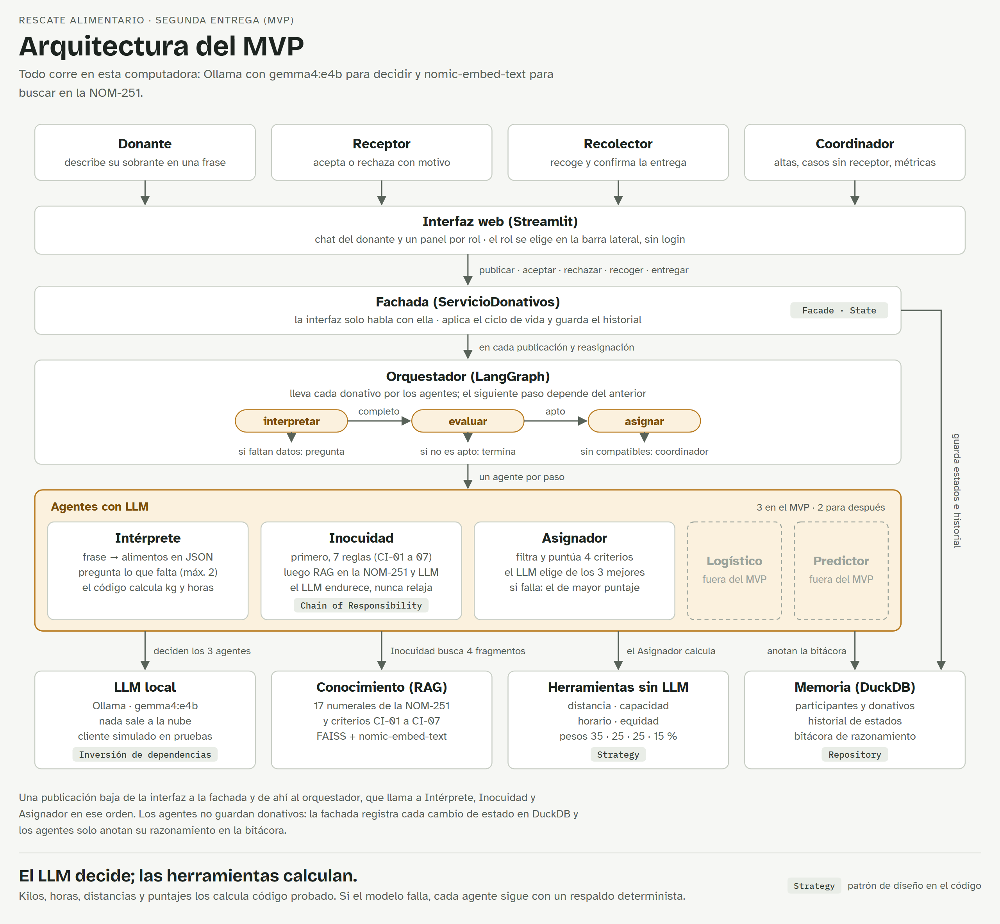
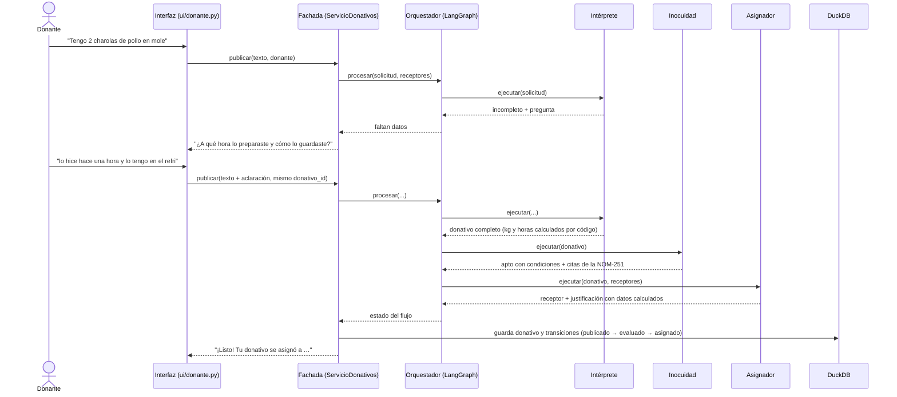
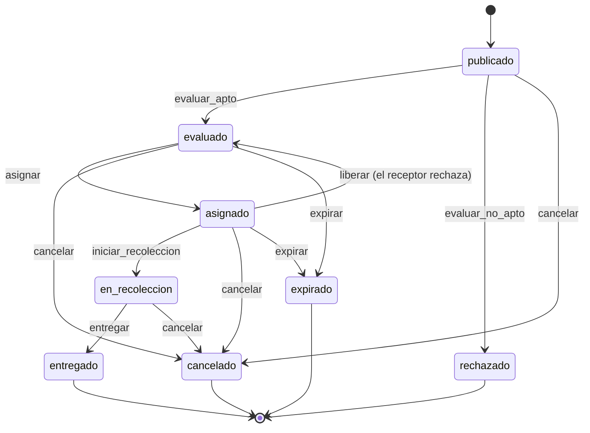

# Arquitectura del MVP

Cómo está construido Rescate Alimentario por dentro: capas, recorrido de un donativo, ciclo de
vida, patrones de diseño y decisiones. Sirve de base para los diagramas UML de la entrega final.

## Capas

| Capa | Dónde | Responsabilidad |
| --- | --- | --- |
| Interfaz | `app.py`, `ui/` | Streamlit con un selector de rol. Cada página expone `mostrar(servicio, participante)` y solo habla con la fachada |
| Fachada | `rescate/servicios.py` | `ServicioDonativos`: único punto de entrada; aplica las transiciones del ciclo de vida y guarda el historial |
| Orquestador | `rescate/orquestador.py` | Grafo de LangGraph: interpretar → evaluar → asignar. Coordina, pero no guarda ni cambia estados |
| Agentes | `rescate/agentes/` | `AgenteInterprete`, `AgenteInocuidad` y `AgenteAsignador`, con la interfaz común `Agente.ejecutar` |
| Herramientas | `rescate/herramientas/` | Cálculos deterministas: distancia, capacidad, horario, equidad, compatibilidad y puntuación |
| Conocimiento | `rescate/rag/`, `datos/conocimiento/` | Extracto textual de la NOM-251-SSA1-2009 y criterios CI-01 a CI-07, indexados con FAISS y `nomic-embed-text` |
| LLM | `rescate/llm/` | `ClienteLLM` (abstracción), `ClienteOllama` (con 2 reintentos) y `ClienteLLMFalso` para las pruebas |
| Persistencia | `rescate/persistencia/` | Repositorios de participantes, donativos (con historial) y bitácora sobre DuckDB |
| Composición | `rescate/contenedor.py` | Crea y conecta todas las piezas según `.env` |

## Recorrido de un donativo

1. **Intérprete.** El LLM convierte la frase en alimentos con el esquema Pydantic `InterpretacionLLM`. El código corrige el tipo de alimento, estima los kilos (`estimar_kg`), convierte expresiones como "hace una hora" (`hora_relativa`) y calcula el límite de recogida (`calcular_recoger_antes_de`). Si a un perecedero le falta la hora o la conservación, pregunta. La interfaz reenvía el texto con `"\nAclaración del donante: "` y el mismo id, con un máximo de 2 aclaraciones.
2. **Inocuidad.** Primero corre la cadena de 7 reglas (`crear_cadena`). Si dicen no apto, ahí termina: el LLM no se consulta, porque no puede relajar un dictamen. Si pasan, busca 4 fragmentos en la base de conocimiento, consulta al LLM con `EvaluacionLLM` y combina los dos resultados quedándose con el más estricto. Las citas que no salieron de un fragmento recuperado se descartan (`filtrar_citas`).
3. **Asignador.** Descarta receptores incompatibles (`evaluar_compatibilidad`: tipos aceptados, refrigeración, rechazos previos), puntúa a los demás con 4 criterios (35 % distancia, 25 % capacidad, 25 % horario, 15 % equidad) y le pasa los 3 mejores al LLM con `DecisionAsignacion`. El sistema rechaza un id fuera de la lista o una elección que no supere al primero en ningún criterio (`tiene_ventaja`); en esos casos, o si el LLM falla, se queda el de mayor puntaje. Con un solo candidato no consulta al modelo, y sin candidatos el caso pasa al coordinador.
4. **Después de asignar.** El receptor acepta (`aceptar_asignacion`) o rechaza con motivo (`rechazar_asignacion`, que libera el donativo y vuelve a correr el Asignador sin el que rechazó). El recolector inicia la recolección y confirma la entrega. El coordinador puede reintentar los casos sin receptor (`reintentar_asignacion`).

## Ciclo de vida del donativo

Cada estado es una clase en `rescate/dominio/estados.py` con su diccionario de transiciones; un evento no permitido lanza `TransicionInvalida`. La aceptación del receptor no cambia de estado: se registra en el historial como `asignado → asignado (aceptar)`. La expiración existe en el modelo, pero en el MVP no hay un botón ni un proceso que la dispare.

## Patrones de diseño

| Patrón | Dónde | Cómo se extiende |
| --- | --- | --- |
| State | `rescate/dominio/estados.py` | Un estado nuevo es una clase con sus transiciones, registrada en `ESTADOS` |
| Facade | `rescate/servicios.py` | Las pantallas nuevas usan los métodos de `ServicioDonativos`; los métodos nuevos se agregan sin cambiar los existentes |
| Chain of Responsibility | `rescate/agentes/reglas_inocuidad.py` | Una regla nueva hereda de `ReglaInocuidad`, implementa `revisar` y se enlaza en `crear_cadena` |
| Strategy | `rescate/herramientas/puntuacion.py` | Un criterio nuevo hereda de `CriterioPuntuacion`; `Puntuador` valida que los pesos sumen 1 |
| Repository | `rescate/persistencia/repositorios.py` | Otra base de datos implementa las mismas interfaces (`RepositorioDonativos`, etc.) |
| Inversión de dependencias | `rescate/llm/cliente.py`, `rescate/agentes/base.py` | Otro proveedor de modelos implementa `ClienteLLM`; los agentes no cambian |
| Orquestación por grafo | `rescate/orquestador.py` | Un agente nuevo es un nodo más del grafo con sus aristas condicionales |
| Raíz de composición | `rescate/contenedor.py` | Es el único archivo que conoce las clases concretas; ahí se conecta cualquier pieza nueva |

## Decisiones de diseño

- **El LLM decide; las herramientas calculan.** Kilos, horas, distancias, capacidades y puntajes los calcula código con pruebas. El modelo interpreta, puede endurecer un dictamen y elige entre candidatos ya calculados.
- **La inocuidad manda.** Ante la duda gana el dictamen más estricto, y un no apto de las reglas no se consulta con el modelo.
- **Respaldo en cada agente.** Si el LLM falla o responde algo que no valida contra su esquema, el agente sigue con reglas deterministas y lo anota como error en la bitácora.
- **Citas comprobadas.** Inocuidad solo acepta numerales de la NOM-251 que aparecen en los fragmentos recuperados.
- **Todo en local.** Ollama corre el modelo y los embeddings en la misma computadora; no se envían datos a servicios de IA externos.
- **Selección validada en lugar de ReAct de varios pasos.** Con un modelo local pequeño, elegir entre 3 candidatos ya calculados resultó más confiable. El ciclo ReAct queda como trabajo futuro.

## Bitácora de razonamiento

Cada agente anota sus pasos con `self._anotar(...)` y la bitácora los guarda en DuckDB en el orden en que ocurrieron.

| Tipo | Ícono | Ejemplo |
| --- | --- | --- |
| Pensamiento | 💭 | "Dona 2 charolas de pollo en mole, un guisado; no dice cuándo lo preparó" |
| Acción | 🛠️ | "Busco en la NOM-251 y en los criterios: pollo en mole…" |
| Observación | 👀 | "3 compatibles; descartados: Casa Hogar San Pedro (no tiene refrigeración)…" |
| Resultado | ✅ | "apto_con_condiciones: …" |
| Error | ⚠️ | "El LLM eligió un receptor fuera de la lista; uso el mayor puntaje calculado" |

La página del donante muestra la bitácora de cada donativo en "¿Cómo lo decidieron los agentes?" y el coordinador la consulta completa, con filtros por agente y por donativo.
