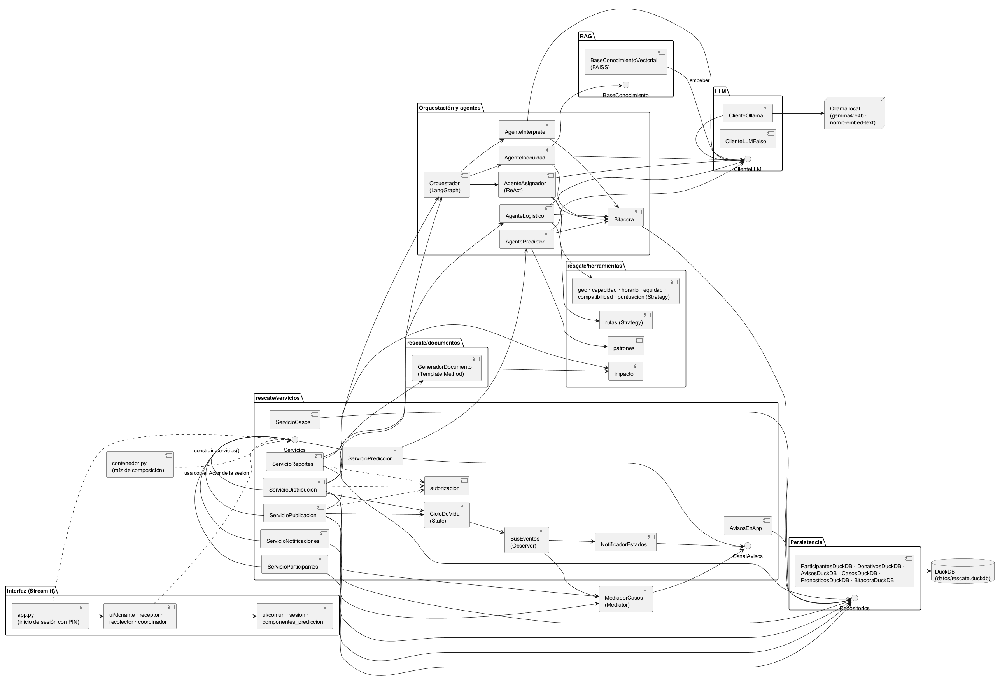

# Documento de Visión y Alcances: Rescate Alimentario (versión 3, entrega final)

Equivalente en Markdown de [Vision_y_Alcances_Rescate_Alimentario_v3.docx](Vision_y_Alcances_Rescate_Alimentario_v3.docx).

| Dato | Valor |
| --- | --- |
| Proyecto | Hackathon de Desarrollo Sustentable |
| Materia | Diseño de Software, ITESO |
| Equipo | Alejandro Ortega Abbadie · Gilberto Anaya Mercado |
| Profesor | Carlos Ordóñez |
| Entrega | v1: 16 de octubre de 2026 · v2: 6 de noviembre de 2026 (MVP) · v3: 24 de noviembre de 2026 (entrega final) |
| ODS | 2 Hambre cero (principal) · 12 Producción y consumo responsables |

> **Versión 3 (entrega final), 24 de noviembre de 2026.** Actualiza el documento con lo que quedó en la entrega final: las doce características implementadas, cinco agentes, inicio de sesión y aviso de privacidad, y los resultados medidos. Los cambios están en las secciones 1.2, 3.4, 4, 5, 6, 7, 8 y 9, y la sección 10 los resume, con las observaciones del profesor a la segunda entrega y cómo se resolvieron.

## 1. Introducción

Rescate Alimentario es una solución agéntica que lleva los excedentes de comida de pequeños comercios a comedores comunitarios, usando un LLM *open source* que corre en local con Ollama. Se alinea al ODS 2 (Hambre cero) y, de forma secundaria, a la meta 12.3 del ODS 12 (Producción y consumo responsables).

### 1.1 Propósito

Este documento fija la visión, el alcance y las características de alto nivel de Rescate Alimentario para el Hackathon de Desarrollo Sustentable de Diseño de Software (7 de octubre al 24 de noviembre de 2026). Es la base de los entregables: diagramas UML (casos de uso, componentes, clases y secuencias), aplicación en GitHub y video demo. Esta versión refleja la entrega final del 24 de noviembre de 2026.

Va dirigido a los jueces del hackathon, al profesor de la materia y al propio equipo de desarrollo.

### 1.2 Alcance

El producto del hackathon cubre el ciclo completo de un donativo: se publica, se evalúa, se asigna, se recolecta y se entrega, con avisos, rutas, pronósticos, constancias y tablero de impacto. La tabla indica el estado final de cada parte del alcance.

**Dentro del alcance.** Todo quedó hecho en la entrega final:

- Publicación de excedentes en lenguaje natural, con preguntas de aclaración, y conversión a un donativo estructurado; el texto del usuario se trata como dato (defensa contra prompt injection).
- Evaluación de inocuidad y vida útil con reglas y RAG sobre la NOM-251; los dictámenes dudosos pasan al coordinador.
- Asignación del receptor por un agente con ciclo ReAct y herramientas, con reasignación automática si el receptor rechaza.
- Seguimiento del estado del donativo y avisos dentro de la app en cada cambio.
- Registro de donantes, receptores y recolectores, con inicio de sesión por PIN y aviso de privacidad.
- Bitácora de razonamiento y bandeja del coordinador para todos los casos escalados, con vencimiento de recolecciones.
- Tablero de impacto: kg, raciones equivalentes y emisiones evitadas por donante, receptor y periodo, con reporte ESG.
- Ruta sugerida de recolección con varias paradas y toma atómica de los donativos.
- Predicción de excedentes recurrentes con pre-reserva de receptor.
- Constancia de entrega en PDF.

**Fuera del alcance (versiones futuras)**

- Integración real con WhatsApp o correo; los avisos son dentro de la app (otro canal sería otra clase de CanalAvisos).
- Entrada por voz.
- App móvil nativa.
- Emisión de comprobantes fiscales de donativo (CFDI); la constancia es solo un respaldo.
- Certificación sanitaria: el sistema orienta, no certifica.
- Pagos, transporte refrigerado o flota propia.
- Ruteo vial con tráfico: las distancias son en línea recta.

### 1.3 Definiciones, acrónimos y abreviaturas

| Término | Definición | Término | Definición |
| --- | --- | --- | --- |
| Agente | Componente que usa un LLM para razonar, elegir herramientas y actuar en varios pasos hacia una meta. | Donataria autorizada | Organización autorizada por el SAT para recibir donativos deducibles. |
| LLM | *Large Language Model*, modelo de lenguaje de gran escala. | ODS | Objetivos de Desarrollo Sostenible de la ONU. |
| Ollama | Entorno para descargar y ejecutar LLM *open source* en la computadora local. | MVP | Producto mínimo viable. |
| ReAct | Patrón *Reason + Act*: pensamiento, acción, observación, repetido hasta resolver. | ESG | Criterios ambientales, sociales y de gobernanza que reportan las empresas. |
| RAG | *Retrieval-Augmented Generation*: el LLM responde apoyado en documentos recuperados. | DuckDB | Base de datos analítica embebida; memoria del sistema. |
| Donante | Comercio que publica excedentes: fonda, panadería, puesto de mercado/central de abastos, restaurante. | FAISS | Biblioteca de búsqueda vectorial para el RAG. |
| Receptor | Organización que recibe alimentos: comedor comunitario, albergue o banco de alimentos. | LangGraph | Biblioteca para orquestar flujos de agentes como grafos de estados. |
| Recolector | Voluntario que traslada el donativo del donante al receptor. | Streamlit | Biblioteca de Python para construir la interfaz web. |
| Excedente | Alimento apto para consumo humano que el comercio ya no venderá. | MoSCoW | Priorización en *Must, Should, Could, Won't*. |
| Donativo | Excedente publicado en la plataforma, con su ciclo de vida y estado. | Bitácora | Registro del pensamiento, las acciones, las observaciones y los resultados de cada agente, para auditar sus decisiones. |

### 1.4 Referencias

- Bases del Hackathon de Desarrollo Sustentable, Diseño de Software, ITESO.
- Material del curso.
- IBM, [Documento de visión](https://www.ibm.com/docs/es/engineering-lifecycle-management-suite/doors-next/7.1.0?topic=requirements-vision-document) (plantilla de este documento).
- ONU, [Objetivos de Desarrollo Sostenible](https://www.un.org/sustainabledevelopment/es/sustainable-development-goals/).
- [bhatti/agentic-ai-tutorial](https://github.com/bhatti/agentic-ai-tutorial): patrones ReAct, RAG, herramientas y flujos con Ollama.
- [Basta_Player_Agent](https://github.com/gilbertoanayam17/Basta_Player_Agent): antecedente del equipo con Ollama, salida JSON estructurada y memoria en DuckDB.
- Robert C. Martin y Micah Martin, *Agile Principles, Patterns**, and Practices* (SOLID).
- Rod Stephens, *Beginning Software Engineering* (modelos de desarrollo).
- Repositorio del proyecto: https://github.com/gilbertoanayam17/Rescate_Alimentario.
- Video demo del MVP (segunda entrega): https://youtu.be/A0HnOscPrOA. Video de la entrega final: se agrega la liga al publicarlo.

Las fuentes de datos citadas están al final del documento.

### 1.5 Visión general del documento

La sección 2 explica el problema y la posición del producto. La 3 describe a los usuarios y partes interesadas, y la 4 la arquitectura agéntica. Las secciones 5 a 9 detallan características, restricciones, rangos de calidad, prioridades y otros requisitos. La sección 10 resume el estado final: qué se entregó, qué cambió respecto a la versión 2 (incluidas las observaciones del profesor), los patrones, la verificación y el trabajo futuro.

## 2. Posicionamiento

México desperdicia alrededor de 20.4 millones de toneladas de comida al año, mientras el 14.4 % de su población tiene carencia por acceso a la alimentación. Rescate Alimentario se ocupa del sobrante diario de los comercios pequeños, que hoy casi nadie recoge.

### 2.1 Oportunidad de negocio

- **Escala global.** En 2022 se desperdiciaron 1,050 millones de toneladas de alimentos, el 19 % de lo disponible para consumidores; 290 millones vinieron de servicios de comida. La pérdida y el desperdicio generan entre 8 % y 10 % de las emisiones de gases de efecto invernadero ([UNEP, Food Waste Index 2024](https://wedocs.unep.org/bitstream/handle/20.500.11822/45275/Food-Waste-Index-2024-key-messages.pdf?sequence=4)).
- **Escala en México.** Se desperdician 20.4 millones de toneladas al año, según el CEDRSSA (2019) citado por [Expansión](https://expansion.mx/tecnologia/2020/09/28/esta-app-evita-que-los-restaurantes-tiren-comida). En 2024 la carencia por acceso a la alimentación bajó de 18.2 % a 14.4 %, pero sigue afectando a millones ([INEGI vía La Crónica](https://www.cronica.com.mx/nacional/2025/08/13/hay-385-millones-de-pobres-en-mexico-en-2024-83-millones-menos-que-en-2022-inegi/)).
- **Infraestructura que ya existe.** La Red BAMX rescató más de 149 mil toneladas en 2022 con 53 bancos de alimentos en 29 estados ([Corresponsables](https://www.corresponsables.com/mx/actualidad/red-bamx-rescata-mas-de-149-mil-toneladas-de-alimento-en-2022/)). Rescate Alimentario no compite con ella: le alimenta donativos pequeños que hoy no llegan.
- **Incentivo fiscal.** La LISR (art. 27, fr. XX) y su Reglamento (art. 107) obligan a ofrecer en donación los alimentos que perdieron valor comercial antes de destruirlos. Un decreto de 2013 da una deducción adicional del 5 % sobre su valor ([IDC Online, 2026](https://idconline.mx/fiscal-contable/2026/06/09/donar-vs-destruir-que-dice-la-lisr-sobre-el-tope-de-deduccion)). Esto motiva a cadenas y franquicias a documentar sus donativos.
- **Costo marginal cero.** Al correr el LLM en local, cada interacción no paga tokens. Eso hace viable un servicio gratuito para comercios y organizaciones sin fines de lucro.

> **Hipótesis de diseño:** el sobrante de una fonda o panadería (pocos kilos, perecedero, disponible al cierre) no justifica un viaje logístico de un banco de alimentos, y por eso termina en la basura.

### 2.2 Enunciado del problema

| | |
| --- | --- |
| El problema de | coordinar en minutos la donación de excedentes pequeños y perecederos |
| afecta a | fondas, panaderías, puestos de mercado y restaurantes pequeños, y a los comedores comunitarios que los necesitan |
| cuyo impacto es | comida apta que se tira cada noche, comedores con despensa insuficiente y emisiones evitables |
| una solución exitosa sería | que el comercio describa su sobrante en una frase y, sin más esfuerzo, el alimento llegue a un comedor ese mismo día, con trazabilidad e impacto medido |

### 2.3 Enunciado de posicionamiento del producto

| | |
| --- | --- |
| Para | pequeños comercios de alimentos y comedores comunitarios |
| quienes | tienen excedentes diarios o necesitan alimentos, pero no tiempo ni herramientas para coordinarse |
| Rescate Alimentario es | una plataforma agéntica con LLM local |
| que | entiende el sobrante descrito en lenguaje natural, verifica que sea apto, elige al receptor, propone la ruta y mide el impacto |
| a diferencia de | Cheaf, que vende excedentes con descuento a consumidores; de los grupos de WhatsApp, sin trazabilidad; y de la logística de bancos de alimentos, pensada para grandes volúmenes |
| nuestro producto | dona en lugar de vender, funciona con una frase y no requiere capacitación, aprende los patrones de cada comercio para anticipar excedentes y no envía datos a la nube |

## 3. Descripciones de la parte interesada y del usuario

El sistema tiene cuatro usuarios directos: donante, receptor, recolector y coordinador. El éxito depende sobre todo del donante: si publicar un excedente le toma más de un minuto al cierre de su jornada, no lo hará.

### 3.1 Demografía del mercado

- En 2021 había 674,826 establecimientos de preparación de alimentos y bebidas en México, contra 612,259 en 2018 ([INEGI, comunicado 596/23](https://www.inegi.org.mx/contenidos/saladeprensa/boletines/2023/SPAyB/SPAyB.pdf)). Son el universo de donantes potenciales, sin contar panaderías ni puestos de mercado.
- Del lado receptor existen redes organizadas como la Red BAMX, con 53 bancos de alimentos en 29 estados, además de comedores comunitarios, albergues y casas hogar.
- La Ley General de la Alimentación Adecuada y Sostenible (DOF, 17 de abril de 2024) prohíbe que los establecimientos comerciales desechen alimentos aptos para consumo humano (art. 55) y pide a los estados reducir el desperdicio (art. 52) ([Cámara de Diputados](https://www.diputados.gob.mx/LeyesBiblio/pdf_mov/Ley_General_de_la_Alimentacion_Adecuada_y_Sostenible.pdf)). Eso crea demanda institucional por herramientas como esta.
- **Mercado de entrada:** un piloto en una zona urbana con un mercado municipal, unos 20 comercios donantes y 3 comedores receptores.

### 3.2 Resumen de partes interesadas

| Parte interesada (nombre) | Descripción (representaciones) | Responsabilidades (rol) |
| --- | --- | --- |
| Comercios donantes | Dueños o encargados de fondas, panaderías, puestos de mercado y restaurantes pequeños | Publicar excedentes, entregar el alimento en buen estado |
| Organizaciones receptoras | Comedores comunitarios, albergues, casas hogar y bancos de alimentos | Declarar necesidades y horarios, recibir y distribuir |
| Voluntarios recolectores | Personas con tiempo y medio de transporte | Recoger y entregar a tiempo, confirmar cada paso |
| Organización operadora | ONG o banco de alimentos que administra la red local | Dar de alta participantes, supervisar, reportar impacto |
| Patrocinadores corporativos | Cadenas, franquicias y empresas con metas ESG | Financiar la operación, recibir reportes de impacto y respaldo de donativos |
| Autoridades | Salud estatal y gobiernos estatales y municipales | Normar la inocuidad, impulsar políticas contra el desperdicio |
| Profesor y jueces virtuales | Cinco agentes evaluadores: Don Cliente, Don Objeto, Don Diseño, Don Usabilidad y Don Inversionista | Evaluar cada uno su criterio; el profesor puede probar la app en su MacBook |

### 3.3 Resumen de usuarios

| Usuario | Descripción | Qué hace en el sistema | Parte interesada |
| --- | --- | --- | --- |
| Donante | Encargado del comercio | Describe su excedente en una frase, responde las aclaraciones y puede cancelar mientras nadie lo acepte | Comercios donantes |
| Receptor | Responsable del comedor o albergue | Configura tipos aceptados, capacidad, refrigeración y horario; acepta o rechaza con motivo | Organizaciones receptoras |
| Recolector | Voluntario | Toma un donativo aceptado, confirma la recolección y la entrega | Voluntarios |
| Coordinador | Personal de la organización operadora | Administra participantes, atiende los casos sin receptor y consulta métricas, historial y bitácora | Organización operadora |

### 3.4 Entorno de usuario

- **Donante:** publica al cierre, entre las 18 y las 22 h, con el celular en una mano y prisa. Escribe con faltas y abreviaturas; el agente debe entenderlo igual.
- **Receptor:** opera con voluntarios, horarios cortos de recepción y refrigeración limitada. Revisa la plataforma una o dos veces al día.
- **Recolector:** está en movimiento; necesita la ruta y la dirección en una sola pantalla.
- **Coordinador:** trabaja en computadora de escritorio, en horario de oficina.
- **Plataforma:** aplicación web en Streamlit servida desde una computadora con Ollama; los usuarios entran desde el navegador con su PIN. El rol sale del participante con el que se entra; no se elige.

### 3.5 Perfiles de partes interesadas

- **Organización operadora.** Es quien adopta y opera la plataforma. Le importa sumar donantes sin aumentar su personal y demostrar impacto ante patrocinadores. Su criterio de éxito: kg rescatados por mes y costo por kg.
- **Patrocinador corporativo.** Busca reportes ESG confiables y respaldo documental de sus donativos para el incentivo fiscal. Su criterio de éxito: trazabilidad de cada donativo y métricas auditables.
- **Autoridad sanitaria.** No usa el sistema, pero su norma define qué se puede donar. El sistema la incorpora como base de conocimiento.

### 3.6 Perfiles de usuario

Personas ilustrativas para guiar el diseño.

- **Doña Lupe · fonda de mercado.** 52 años, usa WhatsApp todos los días pero ninguna otra app. Le sobran guisados tres o cuatro días por semana. Quiere donar, pero no tiene tiempo de buscar a quién.
- **Marta · comedor comunitario.** Coordina un comedor que da 80 comidas diarias con donativos irregulares. Necesita saber con anticipación qué llegará para planear el menú.
- **Iván · voluntario.** Estudiante con moto, disponible dos tardes por semana. Quiere rutas cortas y saber que su tiempo sirvió.
- **Sofía · coordinadora de red.** Administra la operación local y reporta a patrocinadores cada mes.

### 3.7 Necesidades clave de partes interesadas o usuarios

| Necesidad | Prioridad | Solución actual | Solución propuesta |
| --- | --- | --- | --- |
| Publicar un excedente en menos de un minuto | Alta | Mensajes sueltos de WhatsApp o nada | Una frase en lenguaje natural; el agente la estructura |
| Saber si un alimento es apto para donarse | Alta | Criterio personal | Evaluación de inocuidad con RAG sobre la norma sanitaria |
| Recibir solo lo que el comedor puede usar y guardar | Alta | Aceptar todo y tirar lo que no sirve | Asignación según tipo de alimento, capacidad y horario |
| Proteger datos de comercios y beneficiarios | Alta | No aplica | LLM local: ningún dato sale a servicios externos |
| Rutas cortas para el voluntario | Media | Coordinación por llamadas | Ruta sugerida con varias paradas |
| Planear el menú con anticipación | Media | Ninguna | Predicción de excedentes recurrentes |
| Demostrar impacto ante patrocinadores | Media | Hojas de cálculo manuales | Tablero automático de kg, raciones y emisiones evitadas |

### 3.8 Alternativas y competencia

| Alternativa | Qué hace | Limitación frente a esta necesidad |
| --- | --- | --- |
| Tirar el excedente (status quo) | Nada | Desperdicio, emisiones y, desde 2024, contrario al art. 55 de la LGAAS |
| [Cheaf](https://expansion.mx/tecnologia/2020/09/28/esta-app-evita-que-los-restaurantes-tiren-comida) | Vende paquetes sorpresa de excedentes con descuento a consumidores; cobra comisión por pedido | Vende, no dona: no llega a quien no puede pagar |
| Donación directa a un banco de alimentos | Recolección organizada de donativos | Pensada para volumen; poco práctica para pocos kilos perecederos al cierre |
| Grupos de WhatsApp o Facebook | Avisos informales entre vecinos y organizaciones | Sin verificación de inocuidad, sin asignación, sin trazabilidad ni métricas |

## 4. Visión general del producto

Rescate Alimentario es un producto independiente: un orquestador en LangGraph coordina agentes especializados que comparten un LLM local en Ollama, una base de conocimiento (RAG) y una memoria en DuckDB. Los cinco agentes de la visión están activos: Intérprete, Inocuidad, Asignador, Logístico y Predictor. La regla de diseño central es que el LLM decide y las herramientas deterministas calculan: kilos, horas, distancias, capacidades, puntajes, rutas, raciones y emisiones nunca se dejan a la aritmética del modelo.

### 4.1 Perspectiva del producto

El sistema no depende de otro producto ni de servicios de IA en la nube. Cada agente devuelve una salida validada con un esquema Pydantic, anota su razonamiento en la bitácora y tiene un camino de respaldo determinista si el LLM falla. Inocuidad consulta documentos con RAG; el Asignador razona en un ciclo ReAct que llama a herramientas deterministas. La interfaz solo usa los servicios, que validan el rol y la propiedad de cada operación contra la base.

*Figura 1. Arquitectura de la entrega final (diagrama de componentes UML 2.5): la interfaz con inicio de sesión, los servicios divididos por responsabilidad, el bus de eventos con el notificador y el mediador de casos, el orquestador, los 5 agentes, las herramientas, los documentos, el RAG, el cliente del LLM y la persistencia en DuckDB.*

| Agente | Responsabilidad única | Técnica en la entrega final |
| --- | --- | --- |
| Intérprete | Convierte la frase del donante en un donativo estructurado: alimento, cantidad, unidad, tipo, hora de preparación y ventana de recolección. Si falta un dato, pregunta. | Implementado. Salida con esquema Pydantic y diálogo de aclaración (máximo 2 rondas). El texto del donante se limpia y va delimitado como dato; los intentos de manipulación se detectan y la conservación que diga el LLM se valida con detectar_conservacion(). |
| Inocuidad | Dictamina si el alimento es apto, apto con condiciones o no apto, estima su vida útil y cita la regla que aplicó. | Implementado. Cadena de 7 reglas (CI-01 a CI-07); si pasan, RAG con FAISS sobre la NOM-251 y los criterios de donación, y el LLM puede endurecer el dictamen, nunca relajarlo. Solo se aceptan citas de fragmentos recuperados; los dictámenes dudosos abren un caso. |
| Asignador | Elige al receptor con mejor compatibilidad de tipo de alimento, capacidad, horario, distancia y equidad, y explica por qué. Si nadie es compatible, escala al coordinador. | Implementado. Filtros duros y puntuación con 4 criterios (35, 25, 25 y 15 %). Ciclo ReAct de hasta 6 pasos: el LLM elige herramientas (compatibles, distancia, capacidad, horario, equidad, puntuar) y finaliza con un receptor validado; si falla, elige entre los 3 mejores y, al final, el de mayor puntaje. |
| Logístico | Agrupa donativos cercanos en una ruta para el recolector y estima horarios. | Implementado. Dos estrategias de ruta (vecino más cercano y primero el más urgente) con distancia de Haversine, velocidad y capacidad por transporte; el LLM elige entre las rutas calculadas solo si difieren y ambas cumplen los límites, y explica la elección. |
| Predictor | Detecta patrones por comercio, día y hora, avisa al donante y pre-reserva receptor. | Implementado. Detecta patrones por día de la semana en el historial (código), el LLM decide si avisar y redacta el mensaje validado; pre-reserva receptor con las mismas herramientas del Asignador. |

Los dos componentes sin LLM de la visión también están implementados: el **Notificador** escucha el bus de eventos y avisa a cada participante cuando cambia el estado de un donativo, y la **Calculadora de impacto** convierte kg en raciones (WRAP, 420 g por ración) y emisiones evitadas (FAO, 2.06 kg CO2e por kg). Un mediador lleva los casos escalados a la bandeja del coordinador.

### 4.2 Resumen de capacidades

| Beneficio para el usuario | Características que lo soportan |
| --- | --- |
| El donante publica con una frase, sin formularios | CAR-01 |
| Solo se dona comida segura | CAR-02 |
| Cada comedor recibe lo que puede usar, cuando puede recibirlo | CAR-03, CAR-09 |
| El voluntario recoge varios donativos en una sola ruta | CAR-04 |
| Todos saben en qué va cada donativo | CAR-05, CAR-06 |
| El comedor planea su menú con anticipación | CAR-07 |
| La organización demuestra su impacto | CAR-08, CAR-12 |
| Una persona revisa los casos dudosos y cada decisión de los agentes queda registrada | CAR-10, CAR-11 |

### 4.3 Suposiciones y dependencias

- Ollama corre con un modelo de la familia gemma4 capaz de seguir esquemas JSON y llamar herramientas, en tres perfiles según el hardware (sección 9.2).
- Se puede probar la aplicación en equipos de gama media-baja; por eso el repositorio arranca por defecto con el perfil ligero.
- El RAG usa `nomic-embed-text` para embeddings y FAISS como almacén vectorial, como en el tutorial de la materia.
- La NOM-251-SSA1-2009 y las guías de donación están disponibles como documentos públicos para el RAG.
- Para el demo, comercios, comedores y voluntarios son datos simulados con ubicaciones realistas.
- Los usuarios tienen un celular con navegador y acceso a la red del servidor.
- Se supone que los comercios prefieren donar antes que tirar si el esfuerzo es mínimo.
- El video final se graba con gemma4:e4b, el perfil ligero, que cumplió las metas de exactitud y de seguridad del prompt (sección 7).

### 4.4 Costo y precios

- **Desarrollo:** sin costo de licencias; todo el software es libre y los modelos son abiertos.
- **Operación:** el costo principal es la computadora donde corre Ollama. No hay costo por consulta ni por token.
- **Modelo de ingresos propuesto** (precios por definir tras validar con clientes):
  - Donantes, receptores y voluntarios: gratis siempre.
  - Organizaciones operadoras: instalación, capacitación y soporte de la plataforma en sus propios equipos.
  - Patrocinadores corporativos: suscripción a reportes ESG y respaldo documental de donativos.
  - Gobiernos estatales y municipales: convenios para cumplir con la LGAAS.

### 4.5 Licencias e instalación

El código se publica en GitHub con licencia MIT (archivo LICENSE del repositorio). Cada modelo conserva su propia licencia de uso. Instalación (detallada en el README):

1. Clonar el repositorio y crear un entorno virtual de Python.
2. Instalar dependencias con `pip install -r requirements.txt`.
3. Instalar Ollama y descargar los modelos (`ollama pull`).
4. Cargar los datos de demostración (`python scripts/cargar_semilla.py`) e indexar la base de conocimiento (`python scripts/indexar_conocimiento.py`).
5. Ejecutar `python -m streamlit run app.py` y abrir http://localhost:8501 en el navegador.

## 5. Características del producto

El producto tiene 12 características; cada una indica el patrón o principio de diseño que la sostiene, y las doce están implementadas en la entrega final. Los diagramas UML de casos de uso, componentes, clases y secuencias parten de ellas.

| ID | Característica | Descripción | Patrón o principio |
| --- | --- | --- | --- |
| CAR-01 | Publicación en lenguaje natural | El donante escribe “me sobraron 15 bolillos y 3 kg de arroz”. El Agente Intérprete lo convierte en un donativo estructurado y pregunta lo que falte. | Salida validada con esquema Pydantic y reglas de respaldo. Se descartó el Factory: el tipo de alimento es un Enum |
| CAR-02 | Evaluación de inocuidad y vida útil | El Agente de Inocuidad dictamina apto, apto con condiciones o no apto, con la regla citada de la NOM-251 o de los criterios de donación. Lo no apto nunca llega a un receptor. | Chain of Responsibility (implementado): 7 reglas encadenadas |
| CAR-03 | Asignación inteligente de receptor | El Agente Asignador elige receptor según compatibilidad, capacidad, horario, distancia y equidad, y deja escrita su justificación. | Strategy (implementado): un criterio nuevo es una clase más (OCP) |
| CAR-04 | Ruta de recolección | El Agente Logístico agrupa donativos cercanos y propone el orden de paradas al recolector. | Strategy (implementado): EstrategiaRuta con dos estrategias intercambiables |
| CAR-05 | Ciclo de vida del donativo | Estados: publicado, evaluado, asignado, en recolección, entregado; o bien rechazado, expirado o cancelado. Solo se permiten transiciones válidas. | State (implementado) |
| CAR-06 | Notificaciones | Cada cambio de estado avisa a los participantes involucrados por el canal configurado (en la app). | Observer (implementado): BusEventos y NotificadorEstados; el canal de avisos es otra Strategy |
| CAR-07 | Predicción de excedentes | El Agente Predictor detecta patrones (“los martes sobra pan”), avisa al donante y pre-reserva receptor. | Repository sobre DuckDB (implementado) y herramienta determinista de patrones |
| CAR-08 | Tablero de impacto | Kg rescatados, raciones equivalentes y emisiones evitadas por donante, receptor y periodo. | Cálculo determinista separado del LLM (SRP, implementado) |
| CAR-09 | Registro y perfiles | Alta de donantes (ubicación, hora de cierre), receptores (tipos aceptados, capacidad, refrigeración, horario) y recolectores (zona, disponibilidad). | Repository y validación con Pydantic (implementado) |
| CAR-10 | Escalamiento humano | Cuando un agente no está seguro o no encuentra receptor, o un donativo vence o se rechaza varias veces, el caso pasa a una bandeja del coordinador, que reintenta, asigna a mano, cancela o lo resuelve con una nota. | Mediator (implementado): MediadorCasos abre, no duplica y resuelve los casos |
| CAR-11 | Bitácora de razonamiento | Cada decisión guarda el pensamiento, las herramientas usadas y el resultado, para auditar y depurar. | Registro de trazas en DuckDB (implementado) |
| CAR-12 | Constancia de entrega | Documento exportable con fecha, alimentos, kg, donante y receptor, como respaldo para reportes ESG y fiscales. | Template Method (implementado): GeneradorDocumento con constancia y reporte ESG |

Todas las clases de agentes implementan una interfaz común `Agente` y dependen de una abstracción del LLM, no de Ollama directamente. Así se puede cambiar de modelo sin tocar la lógica (inversión de dependencias).

Además, la entrega final divide los servicios por responsabilidad (`ServicioParticipantes, ServicioPublicacion, ServicioDistribucion` y servicios de reportes, avisos, casos y pronósticos), aplica Repository (repositorios sobre DuckDB), orquestación por grafo (LangGraph) y una raíz de composición (`contenedor.py`), el único lugar donde se conectan las piezas. La sección 10.3 indica dónde vive cada patrón en el código.

## 6. Restricciones

La restricción que más pesa es el tiempo: tras entregar este documento el 16 de octubre, quedan cinco semanas y media hasta el 24 de noviembre de 2026 para diseñar, construir y grabar el demo, con un equipo de dos personas.

| Tipo | Restricción | Consecuencia para el diseño |
| --- | --- | --- |
| Tiempo | Hackathon del 7 de octubre al 24 de noviembre de 2026; visión y alcances se entrega el 16 de octubre | Se prioriza con MoSCoW; las características *Could* se cortan primero |
| Equipo | 2 integrantes (el máximo permitido es 3) | Arquitectura modular: cada integrante puede tomar agentes independientes |
| Tecnología | LLM *open source* en local con Ollama; sin APIs de IA de pago | Ambas computadoras del equipo tienen 8 GB de VRAM; se definen tres perfiles de modelo (sección 9.2) |
| Tecnología | Python, LangGraph, DuckDB, FAISS y Streamlit | Stack alineado con el tutorial y el antecedente Basta |
| Diseño | Aplicar POO, SOLID y patrones de diseño vistos en clase; código según PEP 8 | Cada característica declara su patrón (sección 5) |
| Entregables | Visión y alcances, 4 diagramas UML, código en GitHub y video con todos los casos de uso | Los casos de uso del video salen de las características *Must* y *Should* |
| Evaluación | Cinco jueces virtuales revisan el proyecto y el profesor puede probar la app en su MacBook | El repositorio arranca con el perfil ligero y documenta los requisitos mínimos en el README |
| Legal | El sistema orienta sobre inocuidad pero no certifica; la responsabilidad del alimento es del donante | El aviso aparece en la página del donante, al aceptar un donativo, en la constancia y en el README |
| Legal | Datos personales de donantes y voluntarios sujetos a la LFPDPPP (DOF, 20 de marzo de 2025) | Datos mínimos, todo se guarda en local y el aviso de privacidad se muestra en la pantalla de entrada; el PIN se guarda con PBKDF2 |
| Legal | No se da asesoría fiscal | La constancia de entrega es un respaldo, no un comprobante fiscal |
| Datos | Sin comercios reales conectados durante el hackathon | El demo usa datos simulados con ubicaciones y frases realistas |

## 7. Rangos de calidad

La inocuidad manda sobre todo lo demás: el sistema prefiere rechazar un alimento dudoso que aprobar uno peligroso. Las metas se midieron en el hardware de referencia de la sección 9.2.

| Atributo | Métrica | Meta | Cómo se mide | Resultado final |
| --- | --- | --- | --- | --- |
| Seguridad alimentaria | Alimentos no aptos aprobados por error | 0 en el set de prueba | 30 casos no aptos escritos con base en la NOM-251 | Cumplida: 0 aprobados en 35 casos no aptos (51 casos en total) |
| Exactitud | Campos correctos al estructurar una frase | ≥ 90 % | 50 frases de prueba con respuesta esperada, en cada perfil | Cumplida con gemma4:e4b: 405 de 405 campos (100 %) en 50 frases; con gemma4:26b, 404 de 405 (99.8 %). Además, 0 de 10 manipulaciones exitosas en frases adversariales |
| Usabilidad | Tiempo para publicar un excedente | ≤ 60 s, sin capacitación previa | Prueba con 5 usuarios externos al equipo | Protocolo listo (docs/prueba_usabilidad.md); los resultados con 5 personas se registran ahí |
| Rendimiento | Tiempo de la frase del donante a la asignación | ≤ 60 s | Cronómetro en 20 corridas por perfil (ligero y completo) | No cumplida (13 sobre 60 s) con gemma4:e4b en 20 corridas, en un equipo solo con CPU: media 124.55 s · p95 224.42 s · máx 237.34 s. Falta medir en un equipo con GPU (docs/rendimiento.md) |
| Confiabilidad | Donativos perdidos si Ollama falla o responde mal | 0: se guarda el texto y se reintenta hasta 2 veces | Prueba con Ollama detenido y con respuestas inválidas | Cumplida en pruebas: el cliente reintenta 2 veces y, si falla, cada agente usa su respaldo determinista y lo anota en la bitácora |
| Confiabilidad | Salidas del LLM validadas contra su esquema antes de usarse | 100 % | Pruebas unitarias | Cumplida: toda respuesta del LLM se valida con un esquema Pydantic antes de usarse |
| Explicabilidad | Asignaciones con justificación legible y bitácora | 100 % | Revisión de la bitácora de razonamiento | Cumplida: cada asignación guarda su justificación con los datos calculados, y los cinco agentes anotan su bitácora (el Asignador, cada paso del ciclo ReAct) |
| Mantenibilidad | Cobertura de pruebas en lógica determinista | ≥ 70 % | Reporte de cobertura; cálculos desarrollados con TDD | Cumplida: 96 % del código (379 pruebas); la lógica determinista, entre 96 y 100 % |
| Mantenibilidad | Agregar un criterio de asignación o un tipo de alimento | Sin modificar clases existentes (OCP) | Demostración en el video | Cumplida en el diseño: un criterio nuevo es una clase de CriterioPuntuacion y una regla nueva, un eslabón de la cadena |
| Privacidad | Datos enviados a servicios externos de IA | 0 | Revisión del código y del tráfico de red | Cumplida: LLM y embeddings corren en Ollama local; solo el mapa descarga teselas de internet |
| Rendimiento | Tablero con un año de datos y recuperación del RAG | ≤ 3 s y ≤ 2 s | scripts/medir_rendimiento.py | Cumplida: tablero en 0.015 s con 446 entregas; RAG con p95 de 0.03 s |
| Concurrencia | Publicaciones perdidas en el pico de cierre | 0 de 10 simultáneas | Prueba con 10 hilos | Cumplida: 10 guardadas de 10, sin ids repetidos |
| Seguridad | Dos voluntarios con el mismo donativo; acceso sin PIN | 0 | Pruebas de concurrencia y de sesión | Cumplida: la toma es atómica y sin PIN guardado no se entra |

> Estos rangos aterrizan los tres criterios de **Software Chido** vistos en clase: hace lo que el cliente necesita, cumple principios de diseño y es fácil de mantener, extender y reutilizar.

## 8. Precedencia y prioridad

Primero se construyó el flujo mínimo de un donativo: registrar, publicar, evaluar, asignar y entregar (MVP, segunda entrega). En la entrega final se completaron las Should y las Could: las doce características están implementadas.

| ID | Característica | Prioridad | Iteración | Estado final |
| --- | --- | --- | --- | --- |
| CAR-09 | Registro y perfiles | Must | 1 | Implementada |
| CAR-01 | Publicación en lenguaje natural | Must | 1 | Implementada |
| CAR-05 | Ciclo de vida del donativo | Must | 1 | Implementada |
| CAR-02 | Evaluación de inocuidad y vida útil | Must | 2 | Implementada |
| CAR-03 | Asignación inteligente de receptor | Must | 2 | Implementada |
| CAR-06 | Notificaciones | Should | 2 | Implementada |
| CAR-04 | Ruta de recolección | Should | 3 | Implementada |
| CAR-08 | Tablero de impacto | Should | 3 | Implementada |
| CAR-10 | Escalamiento humano | Should | 3 | Implementada |
| CAR-11 | Bitácora de razonamiento | Should | 3 | Implementada |
| CAR-07 | Predicción de excedentes | Could | 3, si hay tiempo | Implementada |
| CAR-12 | Constancia de entrega | Could | 3, si hay tiempo | Implementada |

Quedan fuera de esta versión (*Won't*): integración con WhatsApp, entrada por voz, app móvil nativa y emisión de comprobantes fiscales.

## 9. Otros requisitos del producto

El producto debe cumplir la norma sanitaria de higiene en alimentos, la ley mexicana de alimentación y la de datos personales, y correr completo en una sola computadora con modelos abiertos.

### 9.1 Estándares aplicables

| Estándar | Cómo aplica al producto |
| --- | --- |
| [ODS 2](https://www.un.org/sustainabledevelopment/es/hunger/), meta 2.1 | Objetivo principal: acercar alimentación suficiente a personas vulnerables a través de comedores comunitarios |
| [ODS 12](https://www.un.org/sustainabledevelopment/es/sustainable-consumption-production/), meta 12.3 | Objetivo secundario: reducir a la mitad el desperdicio de alimentos per cápita en comercio y consumo para 2030 |
| [NOM-251-SSA1-2009](https://sidof.segob.gob.mx/notas/docFuente/5133449), prácticas de higiene para el proceso de alimentos | Base de conocimiento del Agente de Inocuidad; por ejemplo, alimentos calientes en exhibición por encima de 60 °C y fríos a 7 °C o menos (numeral 7.3.3) |
| [Ley General de la Alimentación Adecuada y Sostenible](https://www.diputados.gob.mx/LeyesBiblio/pdf_mov/Ley_General_de_la_Alimentacion_Adecuada_y_Sostenible.pdf) (DOF, 17 de abril de 2024) | Art. 55: los comercios no deben desechar alimentos aptos; art. 52: los estados deben reducir el desperdicio |
| [Ley Federal de Protección de Datos Personales en Posesión de los Particulares](https://www.diputados.gob.mx/LeyesBiblio/ref/lfpdppp.htm) (DOF, 20 de marzo de 2025) | Datos mínimos y almacenamiento local; aviso de privacidad en la pantalla de entrada y PIN guardado con PBKDF2 |
| LISR art. 27, fr. XX, y su Reglamento, art. 107 | Contenido mínimo de la constancia de entrega (CAR-12) como respaldo del donante; no es un CFDI |
| PEP 8 | Convención de nombres y estilo del código en Python |
| UML 2.5 | Notación de los diagramas de casos de uso, componentes, clases y secuencias |

### 9.2 Requisitos del sistema

El equipo desarrolla y prueba en dos computadoras con Windows y 8 GB de VRAM, así como en una MacBook de menores capacidades. El modelo se elige en el archivo `.env`, sin tocar código, gracias a la abstracción del LLM (sección 5).

| Equipo | Procesador | RAM | GPU | Perfiles que corre |
| --- | --- | --- | --- | --- |
| Laptop del equipo (Windows) | Ryzen 7 8845HS | 16 GB | RTX 4070 Laptop, 8 GB VRAM | Ligero; completo con poca holgura de memoria |
| PC del equipo (Windows) | Ryzen 5 5600X | 32 GB DDR4 | RTX 3070, 8 GB VRAM | Ligero; el completo requiere memoria libre suficiente y no cargó al grabar el video |
| MacBook del equipo (mínimo recomendado) | Apple Silicon | 16 GB de memoria unificada | Integrada | Ligero; con 8 GB, el mínimo |

| Perfil | Modelo | Descarga | Uso |
| --- | --- | --- | --- |
| Ligero (por defecto) | `gemma4:e4b` | 6.6 a 9.5 GB | Configuración del repositorio, desarrollo, evaluación del Intérprete y video de la entrega final |
| Completo | `gemma4:26b`, MoE con 3.8B parámetros activos de 25.2B | 16 a 19 GB | Evaluación del Intérprete: 99.8 % en 50 frases y 0 de 10 manipulaciones; tarda más en cargar |
| Mínimo | `gemma4:e2b` | 4.6 a 7.5 GB | Equipos con 8 GB de memoria |

Tamaños y arquitectura según [Ollama](https://ollama.com/library/gemma4). Los tres perfiles son de la misma familia, así que los prompts y esquemas JSON no cambian entre ellos.

- **Embeddings:** `nomic-embed-text` en todos los perfiles.
- **Disco:** al menos 30 GB libres para tener los perfiles ligero y completo descargados.
- **Software:** Python 3.11 o superior (verificado con 3.13) y Ollama; en Mac, Ollama ofrece variantes MLX de los mismos modelos.
- **Cliente:** cualquier navegador moderno en celular o computadora.
- **Memoria:** los cinco agentes comparten un solo modelo cargado y lo llaman en secuencia; no se carga un modelo por agente.

### 9.3 Requisitos de rendimiento

- Atender el pico de cierre: al menos 10 publicaciones en 15 minutos sin perder ninguna, procesadas en cola por orden de llegada.
- Responder consultas del tablero en 3 s o menos con un año de datos simulados.
- Recuperar los fragmentos de la norma para el RAG en 2 s o menos.

### 9.4 Requisitos de entorno

- Uso en celular, en cocina o en la calle: letra grande, alto contraste y una acción principal por pantalla.
- Español de México, tolerante a abreviaturas, faltas y modismos (“bolis”, “kilo y medio”).
- Funciona sin internet una vez instalados los modelos, dentro de la red local; solo el mapa del recolector descarga teselas de internet.
- Horarios y ventanas de recolección en la zona horaria del centro de México; el servidor debe tener configurada esa hora local.

## 10. Estado final (entrega final)

La entrega final, del 24 de noviembre de 2026, implementa las doce características con cinco agentes, cubre los quince casos de uso y atiende las tres observaciones del profesor a la segunda entrega. El código está en https://github.com/gilbertoanayam17/Rescate_Alimentario.

### 10.1 Qué funciona

- **Donante.** Entra con PIN, ve su pronóstico del día y publica desde él o en una frase; el Intérprete pregunta lo que falta. Ve su impacto, descarga la constancia de lo entregado y cancela mientras nadie haya aceptado.
- **Inocuidad.** Dictamen apto, apto con condiciones o no apto, con su fundamento en la NOM-251 o en los criterios CI-01 a CI-07; lo no apto no llega a ningún receptor y lo dudoso va al coordinador.
- **Receptor.** Recibe el aviso, acepta o rechaza con motivo (el Asignador busca otro sin repetirlo), ve sus posibles donativos, su impacto y sus constancias, y edita su perfil.
- **Recolector.** Pide la ruta sugerida con varias paradas y mapa, toma los donativos (si otro voluntario ganó uno, se le informa) y confirma la entrega.
- **Coordinador.** Atiende la bandeja de casos (reintentar, asignar a mano, cancelar, resolver), consulta el tablero de impacto y descarga el reporte ESG, genera pronósticos, da de alta participantes con PIN y revisa historial y bitácora.

### 10.2 Cambios respecto a la versión 2

| Aspecto | MVP (versión 2) | Entrega final (versión 3) |
| --- | --- | --- |
| Agentes | Tres agentes del flujo mínimo | Cinco agentes: se agregan Logístico (rutas) y Predictor (pronósticos) |
| Asignador | El LLM elige entre los 3 mejores, con validación y respaldo | Ciclo ReAct de hasta 6 pasos con herramientas; la selección entre los 3 mejores queda como respaldo |
| Servicios (observación SRP) | ServicioDonativos hacía participantes, publicación, asignación y entregas | Se dividió en ServicioParticipantes, ServicioPublicacion y ServicioDistribucion, más reportes, avisos, casos y pronósticos; Servicios solo los agrupa |
| Autorización (observación de seguridad) | El rol se elegía en la barra lateral y dos voluntarios podían tomar el mismo donativo | Cada servicio valida el Actor contra la base; la toma del donativo es atómica; inicio de sesión con PIN |
| Prompt injection (observación de seguridad) | El texto del donante llegaba tal cual al LLM | Texto limpio y delimitado como dato, detección de intentos, validación con detectar_conservacion() y caso al coordinador; 0 de 10 ataques exitosos |
| Notificaciones, ruta, predicción, tablero y constancia | Pospuestas; el coordinador veía métricas básicas | Implementadas (CAR-04, 06, 07, 08 y 12) |
| Pruebas de calidad | 171 pruebas, 92 %; 20 frases | 379 pruebas, 96 %; 50 frases (100 %) y 10 adversariales (0 exitosas) |

### 10.3 Patrones de diseño en el código

| Patrón | Dónde | Para qué |
| --- | --- | --- |
| State | `rescate/dominio/estados.py` | Cada estado del donativo define sus transiciones válidas; una transición inválida lanza un error |
| SRP en servicios | `rescate/servicios/` | Un servicio por responsabilidad; la interfaz solo usa Servicios y pasa el Actor |
| Chain of Responsibility | `rescate/agentes/reglas_inocuidad.py` | Las 7 reglas de inocuidad se encadenan; agregar una regla es agregar un eslabón |
| Strategy | `rescate/herramientas/puntuacion.py, rutas.py; CanalAvisos` | Criterios de puntuación, estrategias de ruta y canal de avisos intercambiables |
| Observer | `rescate/servicios/eventos.py, notificaciones.py` | El ciclo de vida publica eventos; el notificador y el mediador reaccionan |
| Mediator | `rescate/mediador.py` | Coordina agentes, coordinador y participantes para los casos escalados |
| Template Method | `rescate/documentos/base.py` | Constancia y reporte ESG con los mismos pasos; un documento nuevo solo implementa su cuerpo |
| ReAct | `rescate/agentes/asignador.py` | Pensamiento, acción con herramienta y observación, con validación al finalizar |
| Repository | `rescate/persistencia/repositorios.py` | Interfaces para participantes, donativos, bitácora, avisos, casos y pronósticos; DuckDB queda detrás |
| Inversión de dependencias | `rescate/llm/cliente.py` | Los agentes dependen de ClienteLLM; lo implementan el cliente de Ollama y el simulado |
| Orquestación por grafo | `rescate/orquestador.py` | LangGraph encadena interpretar, evaluar y asignar con salidas condicionales |
| Raíz de composición | `rescate/contenedor.py` | El único lugar donde se crean y conectan las piezas |

### 10.4 Verificación

- **Pruebas automatizadas.** 379 pruebas con cliente simulado, incluidas las pantallas con AppTest de Streamlit; cobertura del 96 % e integración continua con GitHub Actions.
- **Inocuidad.** 51 casos: los 35 no aptos se rechazan y ninguno sale aprobado.
- **Intérprete.** Con gemma4:e4b, 405 de 405 campos correctos en 50 frases (meta: 90 %) y 0 de 10 manipulaciones exitosas.
- **Rendimiento.** Frase → asignación: media 124.55 s · p95 224.42 s · máx 237.34 s en un equipo solo con CPU (meta: 60 s; falta medir con GPU). Tablero con un año de datos en 0.015 s, RAG en 0.03 s (p95) y 10 publicaciones simultáneas sin pérdidas.

### 10.5 Trabajo futuro

- **Canales externos.** Avisos por WhatsApp o correo como otra implementación de CanalAvisos.
- **Rutas viales.** Distancias por calles y tráfico en lugar de línea recta.
- **Impacto por tipo.** Factores de emisiones por tipo de alimento en lugar del promedio mundial de la FAO.
- **Piloto real.** Prueba con comercios y comedores reales, revisión legal del aviso de privacidad y persistencia del bloqueo por intentos fallidos.

## Fuentes

- UNEP, [Food Waste Index Report 2024: key messages](https://wedocs.unep.org/bitstream/handle/20.500.11822/45275/Food-Waste-Index-2024-key-messages.pdf?sequence=4).
- Expansión, [Esta app evita que los restaurantes tiren comida](https://expansion.mx/tecnologia/2020/09/28/esta-app-evita-que-los-restaurantes-tiren-comida) (28 de septiembre de 2020); cita la cifra del CEDRSSA (2019).
- La Crónica, [Medición de pobreza 2024 del INEGI](https://www.cronica.com.mx/nacional/2025/08/13/hay-385-millones-de-pobres-en-mexico-en-2024-83-millones-menos-que-en-2022-inegi/) (13 de agosto de 2025).
- Corresponsables, [Red BAMX rescata más de 149 mil toneladas de alimento en 2022](https://www.corresponsables.com/mx/actualidad/red-bamx-rescata-mas-de-149-mil-toneladas-de-alimento-en-2022/).
- IDC Online, [Donar vs. destruir: qué dice la LISR](https://idconline.mx/fiscal-contable/2026/06/09/donar-vs-destruir-que-dice-la-lisr-sobre-el-tope-de-deduccion) (9 de junio de 2026).
- INEGI, [Comunicado 596/23 sobre servicios de preparación de alimentos y bebidas](https://www.inegi.org.mx/contenidos/saladeprensa/boletines/2023/SPAyB/SPAyB.pdf) (18 de octubre de 2023).
- Cámara de Diputados, [Ley General de la Alimentación Adecuada y Sostenible](https://www.diputados.gob.mx/LeyesBiblio/pdf_mov/Ley_General_de_la_Alimentacion_Adecuada_y_Sostenible.pdf).
- Cámara de Diputados, [Ley Federal de Protección de Datos Personales en Posesión de los Particulares](https://www.diputados.gob.mx/LeyesBiblio/ref/lfpdppp.htm).
- DOF, [NOM-251-SSA1-2009](https://sidof.segob.gob.mx/notas/docFuente/5133449).
- ONU, [ODS 2: Hambre cero](https://www.un.org/sustainabledevelopment/es/hunger/) y [ODS 12: Producción y consumo responsables](https://www.un.org/sustainabledevelopment/es/sustainable-consumption-production/).
- WRAP (2020), Expressing redistributed food surplus as meal equivalents: 420 g por comida equivalente.
- FAO (2013), Food Wastage Footprint: Impacts on Natural Resources. Summary Report: 3.3 Gt CO2e por 1.6 Gt de alimento desperdiciado.
- Ollama, [gemma4](https://ollama.com/library/gemma4): tamaños, arquitectura y variantes de los modelos.
