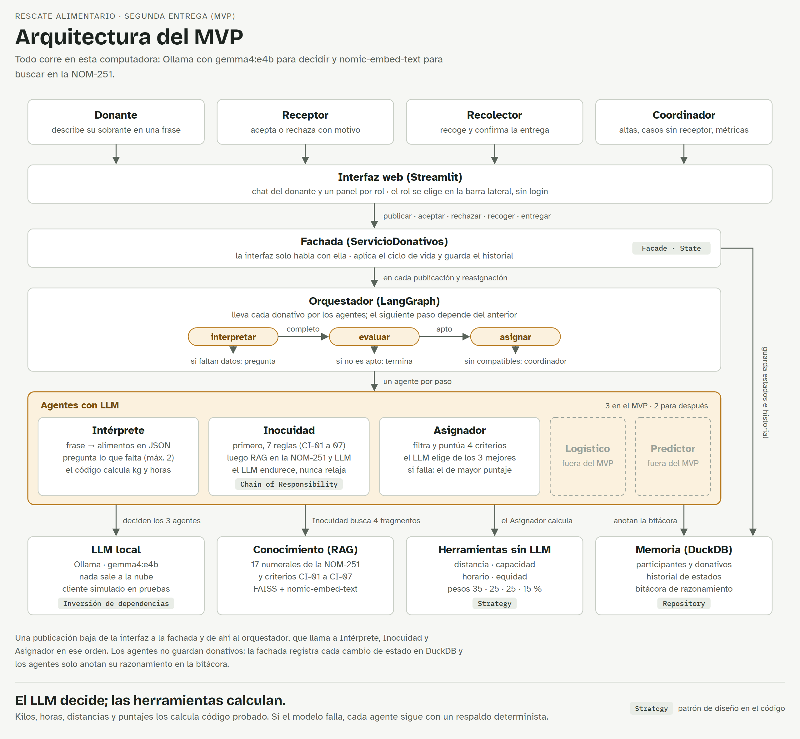

# Documento de Visión y Alcances: Rescate Alimentario (versión 2, MVP)

*Del sobrante de la fonda al comedor comunitario, con agentes de IA que corren en local*

Equivalente en Markdown de [Vision_y_Alcances_Rescate_Alimentario_v2.docx](Vision_y_Alcances_Rescate_Alimentario_v2.docx).

| Dato | Valor |
| --- | --- |
| Proyecto | Hackathon de Desarrollo Sustentable |
| Materia | Diseño de Software, ITESO |
| Equipo | Alejandro Ortega Abbadie · Gilberto Anaya Mercado |
| Profesor | Carlos Ordóñez |
| Entrega | v1: 16 de octubre de 2026 · v2: 6 de noviembre de 2026 (MVP) |
| ODS | 2 Hambre cero (principal) · 12 Producción y consumo responsables |

> **Versión 2, 6 de noviembre de 2026.** Actualiza el documento con lo que se construyó en el MVP de la segunda entrega: qué quedó hecho, qué es parcial y qué se pospuso. Los cambios están en las secciones 1.2, 3.3, 4, 5, 7 y 8, y la sección 10 los resume.

## 1. Introducción

Rescate Alimentario es una solución agéntica que lleva los excedentes de comida de pequeños comercios a comedores comunitarios, usando un LLM *open source* que corre en local con Ollama. Se alinea al ODS 2 (Hambre cero) y, de forma secundaria, a la meta 12.3 del ODS 12 (Producción y consumo responsables).

### 1.1 Propósito

Este documento fija la visión, el alcance y las características de alto nivel de Rescate Alimentario para el Hackathon de Desarrollo Sustentable de Diseño de Software (7 de octubre al 24 de noviembre de 2026). Es la base de los entregables siguientes: diagramas UML (casos de uso, componentes, clases y secuencias), aplicación en GitHub y video demo. Esta versión refleja el MVP entregado el 6 de noviembre de 2026.

Va dirigido a los jueces del hackathon, al profesor de la materia y al propio equipo de desarrollo.

### 1.2 Alcance

El producto del hackathon es un MVP funcional que cubre el ciclo completo de un donativo: se publica, se evalúa, se asigna, se recolecta y se entrega. El MVP de la segunda entrega ya cubre ese ciclo; la tabla indica qué quedó hecho, qué es parcial y qué se pospuso.

**Dentro del alcance: estado en el MVP**

- **Hecho.** Publicación de excedentes en lenguaje natural, con preguntas de aclaración, y conversión a un donativo estructurado.
- **Hecho.** Evaluación de inocuidad y vida útil con reglas y RAG sobre la NOM-251.
- **Hecho.** Asignación del receptor por un agente con herramientas, con reasignación automática si el receptor rechaza.
- **Hecho.** Seguimiento del estado del donativo, de la publicación a la entrega.
- **Hecho.** Registro de donantes, receptores y recolectores.
- **Hecho.** Bitácora de razonamiento y bandeja del coordinador para casos sin receptor.
- **Parcial.** Tablero de impacto: kg entregados, donativos activos, no aptos y casos sin receptor; faltan raciones y emisiones evitadas.
- **Pospuesto.** Ruta sugerida de recolección; el recolector ve origen, destino, mapa y distancia en línea recta.
- **Pospuesto.** Predicción de excedentes recurrentes a partir del historial.

**Fuera del alcance (versiones futuras)**

- Integración real con WhatsApp; en el MVP se simula con un chat web.
- Entrada por voz.
- App móvil nativa.
- Emisión de comprobantes fiscales de donativo (CFDI).
- Certificación sanitaria: el sistema orienta, no certifica.
- Pagos, transporte refrigerado o flota propia.
- Inicio de sesión: en el MVP el rol y el participante se eligen en la barra lateral.

### 1.3 Definiciones, acrónimos y abreviaturas

| Término | Definición | Término | Definición |
| --- | --- | --- | --- |
| **Agente** | Componente que usa un LLM para razonar, elegir herramientas y actuar en varios pasos hacia una meta. | **Donataria autorizada** | Organización autorizada por el SAT para recibir donativos deducibles. |
| **LLM** | *Large Language Model*, modelo de lenguaje de gran escala. | **ODS** | Objetivos de Desarrollo Sostenible de la ONU. |
| **Ollama** | Entorno para descargar y ejecutar LLM *open source* en la computadora local. | **MVP** | Producto mínimo viable. |
| **ReAct** | Patrón *Reason + Act*: pensamiento, acción, observación, repetido hasta resolver. | **ESG** | Criterios ambientales, sociales y de gobernanza que reportan las empresas. |
| **RAG** | *Retrieval-Augmented Generation*: el LLM responde apoyado en documentos recuperados. | **DuckDB** | Base de datos analítica embebida; memoria del sistema. |
| **Donante** | Comercio que publica excedentes: fonda, panadería, puesto de mercado/central de abastos, restaurante. | **FAISS** | Biblioteca de búsqueda vectorial para el RAG. |
| **Receptor** | Organización que recibe alimentos: comedor comunitario, albergue o banco de alimentos. | **LangGraph** | Biblioteca para orquestar flujos de agentes como grafos de estados. |
| **Recolector** | Voluntario que traslada el donativo del donante al receptor. | **Streamlit** | Biblioteca de Python para construir la interfaz web. |
| **Excedente** | Alimento apto para consumo humano que el comercio ya no venderá. | **MoSCoW** | Priorización en *Must, Should, Could, Won't*. |
| **Donativo** | Excedente publicado en la plataforma, con su ciclo de vida y estado. | **Bitácora** | Registro del pensamiento, las acciones, las observaciones y los resultados de cada agente, para auditar sus decisiones. |

### 1.4 Referencias

- Bases del Hackathon de Desarrollo Sustentable, Diseño de Software, ITESO.
- Material del curso.
- IBM, [Documento de visión](https://www.ibm.com/docs/es/engineering-lifecycle-management-suite/doors-next/7.1.0?topic=requirements-vision-document) (plantilla de este documento).
- ONU, [Objetivos de Desarrollo Sostenible](https://www.un.org/sustainabledevelopment/es/sustainable-development-goals/).
- [bhatti/agentic-ai-tutorial](https://github.com/bhatti/agentic-ai-tutorial): patrones ReAct, RAG, herramientas y flujos con Ollama.
- [Basta_Player_Agent](https://github.com/gilbertoanayam17/Basta_Player_Agent): antecedente del equipo con Ollama, salida JSON estructurada y memoria en DuckDB.
- Robert C. Martin y Micah Martin, *Agile Principles, Patterns, and Practices* (SOLID).
- Rod Stephens, *Beginning Software Engineering* (modelos de desarrollo).
- Repositorio del proyecto: https://github.com/gilbertoanayam17/Rescate_Alimentario.
- Video demo del MVP (segunda entrega): https://youtu.be/A0HnOscPrOA.

Las fuentes de datos citadas están al final del documento.

### 1.5 Visión general del documento

La sección 2 explica el problema y la posición del producto. La 3 describe a los usuarios y partes interesadas, y la 4 la arquitectura agéntica. Las secciones 5 a 9 detallan características, restricciones, rangos de calidad, prioridades y otros requisitos. La sección 10, nueva en esta versión, resume qué se entregó en el MVP, qué cambió respecto a la versión 1 y qué queda pendiente.

## 2. Posicionamiento

México desperdicia alrededor de 20.4 millones de toneladas de comida al año, mientras el 14.4 % de su población tiene carencia por acceso a la alimentación. Rescate Alimentario ataca la “última milla” de ese desperdicio: el sobrante diario de los comercios pequeños, que hoy nadie recoge.

### 2.1 Oportunidad de negocio

- **Escala global.** En 2022 se desperdiciaron 1,050 millones de toneladas de alimentos, el 19 % de lo disponible para consumidores; 290 millones vinieron de servicios de comida. La pérdida y el desperdicio generan entre 8 % y 10 % de las emisiones de gases de efecto invernadero ([UNEP, Food Waste Index 2024](https://wedocs.unep.org/bitstream/handle/20.500.11822/45275/Food-Waste-Index-2024-key-messages.pdf?sequence=4)).
- **Escala en México.** Se desperdician 20.4 millones de toneladas al año, según el CEDRSSA (2019) citado por [Expansión](https://expansion.mx/tecnologia/2020/09/28/esta-app-evita-que-los-restaurantes-tiren-comida). En 2024 la carencia por acceso a la alimentación bajó de 18.2 % a 14.4 %, pero sigue afectando a millones ([INEGI vía La Crónica](https://www.cronica.com.mx/nacional/2025/08/13/hay-385-millones-de-pobres-en-mexico-en-2024-83-millones-menos-que-en-2022-inegi/)).
- **Infraestructura que ya existe.** La Red BAMX rescató más de 149 mil toneladas en 2022 con 53 bancos de alimentos en 29 estados ([Corresponsables](https://www.corresponsables.com/mx/actualidad/red-bamx-rescata-mas-de-149-mil-toneladas-de-alimento-en-2022/)). Rescate Alimentario no compite con ella: le alimenta donativos pequeños que hoy no llegan.
- **Incentivo fiscal.** La LISR (art. 27, fr. XX) y su Reglamento (art. 107) obligan a ofrecer en donación los alimentos que perdieron valor comercial antes de destruirlos. Un decreto de 2013 da una deducción adicional del 5 % sobre su valor ([IDC Online, 2026](https://idconline.mx/fiscal-contable/2026/06/09/donar-vs-destruir-que-dice-la-lisr-sobre-el-tope-de-deduccion)). Esto motiva a cadenas y franquicias a documentar sus donativos.
- **Costo marginal cero.** Al correr el LLM en local, cada interacción no paga tokens. Eso hace viable un servicio gratuito para comercios y organizaciones sin fines de lucro.

> **Hipótesis de diseño:** el sobrante de una fonda o panadería (pocos kilos, perecedero, disponible al cierre) no justifica un viaje logístico de un banco de alimentos, y por eso termina en la basura.

### 2.2 Enunciado del problema

| | |
| --- | --- |
| **El problema de** | coordinar en minutos la donación de excedentes pequeños y perecederos |
| **afecta a** | fondas, panaderías, puestos de mercado y restaurantes pequeños, y a los comedores comunitarios que los necesitan |
| **cuyo impacto es** | comida apta que se tira cada noche, comedores con despensa insuficiente y emisiones evitables |
| **una solución exitosa sería** | que el comercio describa su sobrante en una frase y, sin más esfuerzo, el alimento llegue a un comedor ese mismo día, con trazabilidad e impacto medido |

### 2.3 Enunciado de posicionamiento del producto

| | |
| --- | --- |
| **Para** | pequeños comercios de alimentos y comedores comunitarios |
| **quienes** | tienen excedentes diarios o necesitan alimentos, pero no tiempo ni herramientas para coordinarse |
| **Rescate Alimentario es** | una plataforma agéntica con LLM local |
| **que** | entiende el sobrante descrito en lenguaje natural, verifica que sea apto, elige al receptor, propone la ruta y mide el impacto |
| **a diferencia de** | Cheaf, que vende excedentes con descuento a consumidores; de los grupos de WhatsApp, sin trazabilidad; y de la logística de bancos de alimentos, pensada para grandes volúmenes |
| **nuestro producto** | dona en lugar de vender, funciona con una frase y no requiere capacitación, aprende los patrones de cada comercio para anticipar excedentes y no envía datos a la nube |

## 3. Descripciones de la parte interesada y del usuario

El sistema tiene cuatro usuarios directos: donante, receptor, recolector y coordinador. El éxito depende sobre todo del donante: si publicar un excedente le toma más de un minuto al cierre de su jornada, no lo hará.

### 3.1 Demografía del mercado

- En 2021 había 674,826 establecimientos de preparación de alimentos y bebidas en México, contra 612,259 en 2018 ([INEGI, comunicado 596/23](https://www.inegi.org.mx/contenidos/saladeprensa/boletines/2023/SPAyB/SPAyB.pdf)). Son el universo de donantes potenciales, sin contar panaderías ni puestos de mercado.
- Del lado receptor existen redes organizadas como la Red BAMX, con 53 bancos de alimentos en 29 estados, además de comedores comunitarios, albergues y casas hogar.
- La Ley General de la Alimentación Adecuada y Sostenible (DOF, 17 de abril de 2024) prohíbe que los establecimientos comerciales desechen alimentos aptos para consumo humano (art. 55) y pide a los estados reducir el desperdicio (art. 52) ([Cámara de Diputados](https://www.diputados.gob.mx/LeyesBiblio/pdf_mov/Ley_General_de_la_Alimentacion_Adecuada_y_Sostenible.pdf)). Eso crea demanda institucional por herramientas como esta.
- **Mercado de entrada:** un piloto en una zona urbana con un mercado municipal, unos 20 comercios donantes y 3 comedores receptores.

### 3.2 Resumen de partes interesadas

| Parte interesada (nombre) | Descripción (representaciones) | Responsabilidades (rol) |
| --- | --- | --- |
| **Comercios donantes** | Dueños o encargados de fondas, panaderías, puestos de mercado y restaurantes pequeños | Publicar excedentes, entregar el alimento en buen estado |
| **Organizaciones receptoras** | Comedores comunitarios, albergues, casas hogar y bancos de alimentos | Declarar necesidades y horarios, recibir y distribuir |
| **Voluntarios recolectores** | Personas con tiempo y medio de transporte | Recoger y entregar a tiempo, confirmar cada paso |
| **Organización operadora** | ONG o banco de alimentos que administra la red local | Dar de alta participantes, supervisar, reportar impacto |
| **Patrocinadores corporativos** | Cadenas, franquicias y empresas con metas ESG | Financiar la operación, recibir reportes de impacto y respaldo de donativos |
| **Autoridades** | Salud estatal y gobiernos estatales y municipales | Normar la inocuidad, impulsar políticas contra el desperdicio |
| **Profesor y jueces virtuales** | Cinco agentes evaluadores: Don Cliente, Don Objeto, Don Diseño, Don Usabilidad y Don Inversionista | Evaluar cada uno su criterio; el profesor puede probar la app en su MacBook |

### 3.3 Resumen de usuarios

| Usuario | Descripción | Qué hace en el sistema | Parte interesada |
| --- | --- | --- | --- |
| **Donante** | Encargado del comercio | Describe su excedente en una frase, responde las aclaraciones y puede cancelar mientras nadie lo acepte | Comercios donantes |
| **Receptor** | Responsable del comedor o albergue | Configura tipos aceptados, capacidad, refrigeración y horario; acepta o rechaza con motivo | Organizaciones receptoras |
| **Recolector** | Voluntario | Toma un donativo aceptado, confirma la recolección y la entrega | Voluntarios |
| **Coordinador** | Personal de la organización operadora | Administra participantes, atiende los casos sin receptor y consulta métricas, historial y bitácora | Organización operadora |

### 3.4 Entorno de usuario

- **Donante:** publica al cierre, entre las 18 y las 22 h, con el celular en una mano y prisa. Escribe con faltas y abreviaturas; el agente debe entenderlo igual.
- **Receptor:** opera con voluntarios, horarios cortos de recepción y refrigeración limitada. Revisa la plataforma una o dos veces al día.
- **Recolector:** está en movimiento; necesita la ruta y la dirección en una sola pantalla.
- **Coordinador:** trabaja en computadora de escritorio, en horario de oficina.
- **Plataforma del MVP:** aplicación web en Streamlit servida desde una computadora con Ollama; los usuarios entran desde el navegador. En el MVP no hay inicio de sesión: el rol y el participante se eligen en la barra lateral.

### 3.5 Perfiles de partes interesadas

- **Organización operadora.** Es quien adopta y opera la plataforma. Le importa sumar donantes sin aumentar su personal y demostrar impacto ante patrocinadores. Su criterio de éxito: kg rescatados por mes y costo por kg.
- **Patrocinador corporativo.** Busca reportes ESG confiables y respaldo documental de sus donativos para el incentivo fiscal. Su criterio de éxito: trazabilidad de cada donativo y métricas auditables.
- **Autoridad sanitaria.** No usa el sistema, pero su norma define qué se puede donar. El sistema la incorpora como base de conocimiento.

### 3.6 Perfiles de usuario

Personas ilustrativas para guiar el diseño.

- **Doña Lupe · fonda de mercado.** 52 años, usa WhatsApp todos los días pero ninguna otra app. Le sobran guisados tres o cuatro días por semana. Quiere donar, pero no tiene tiempo de buscar a quién.
- **Marta · comedor comunitario.** Coordina un comedor que da 80 comidas diarias con donativos irregulares. Necesita saber con anticipación qué llegará para planear el menú.
- **Iván · voluntario.** Estudiante con moto, disponible dos tardes por semana. Quiere rutas cortas y saber que su tiempo sirvió.
- **Sofía · coordinadora de red.** Administra la operación local y reporta a patrocinadores cada mes.

### 3.7 Necesidades clave de partes interesadas o usuarios

| Necesidad | Prioridad | Solución actual | Solución propuesta |
| --- | --- | --- | --- |
| Publicar un excedente en menos de un minuto | Alta | Mensajes sueltos de WhatsApp o nada | Una frase en lenguaje natural; el agente la estructura |
| Saber si un alimento es apto para donarse | Alta | Criterio personal | Evaluación de inocuidad con RAG sobre la norma sanitaria |
| Recibir solo lo que el comedor puede usar y guardar | Alta | Aceptar todo y tirar lo que no sirve | Asignación según tipo de alimento, capacidad y horario |
| Proteger datos de comercios y beneficiarios | Alta | No aplica | LLM local: ningún dato sale a servicios externos |
| Rutas cortas para el voluntario | Media | Coordinación por llamadas | Ruta sugerida con varias paradas |
| Planear el menú con anticipación | Media | Ninguna | Predicción de excedentes recurrentes |
| Demostrar impacto ante patrocinadores | Media | Hojas de cálculo manuales | Tablero automático de kg, raciones y emisiones evitadas |

### 3.8 Alternativas y competencia

| Alternativa | Qué hace | Limitación frente a esta necesidad |
| --- | --- | --- |
| **Tirar el excedente (status quo)** | Nada | Desperdicio, emisiones y, desde 2024, contrario al art. 55 de la LGAAS |
| [Cheaf](https://expansion.mx/tecnologia/2020/09/28/esta-app-evita-que-los-restaurantes-tiren-comida) | Vende paquetes sorpresa de excedentes con descuento a consumidores; cobra comisión por pedido | Vende, no dona: no llega a quien no puede pagar |
| **Donación directa a un banco de alimentos** | Recolección organizada de donativos | Pensada para volumen; poco práctica para pocos kilos perecederos al cierre |
| **Grupos de WhatsApp o Facebook** | Avisos informales entre vecinos y organizaciones | Sin verificación de inocuidad, sin asignación, sin trazabilidad ni métricas |

## 4. Visión general del producto

Rescate Alimentario es un producto independiente: un orquestador en LangGraph coordina agentes especializados que comparten un LLM local en Ollama, una base de conocimiento (RAG) y una memoria en DuckDB. La visión contempla cinco agentes; el MVP implementa los tres del flujo mínimo (Intérprete, Inocuidad y Asignador) y deja al Logístico y al Predictor para después. La regla de diseño central es que el LLM decide y las herramientas deterministas calculan: kilos, horas, distancias, capacidades y puntajes nunca se dejan a la aritmética del modelo.

### 4.1 Perspectiva del producto

El sistema no depende de otro producto ni de servicios de IA en la nube. En el MVP, cada agente devuelve una salida validada con un esquema Pydantic, anota su razonamiento en la bitácora y tiene un camino de respaldo determinista si el LLM falla. Inocuidad consulta documentos con RAG y el Asignador usa herramientas deterministas; el ciclo ReAct de varios pasos queda como trabajo futuro.

*Figura 1. Arquitectura del MVP: 4 roles, la interfaz, la fachada, el orquestador y los 3 agentes activos (Logístico y Predictor quedan fuera del MVP), con 4 recursos locales. La fachada guarda estados e historial; los agentes anotan su razonamiento en la bitácora. Las etiquetas grises marcan los patrones de diseño.*

| Agente | Responsabilidad única | Técnica en el MVP |
| --- | --- | --- |
| **Intérprete** | Convierte la frase del donante en un donativo estructurado: alimento, cantidad, unidad, tipo, hora de preparación y ventana de recolección. Si falta un dato, pregunta. | **Implementado.** Salida con esquema Pydantic y diálogo de aclaración (máximo 2 rondas); kilos, horas y límite de recogida los calcula el código. |
| **Inocuidad** | Dictamina si el alimento es apto, apto con condiciones o no apto, estima su vida útil y cita la regla que aplicó. | **Implementado.** Cadena de 7 reglas (CI-01 a CI-07); si pasan, RAG con FAISS sobre la NOM-251 y los criterios de donación, y el LLM puede endurecer el dictamen, nunca relajarlo. Solo se aceptan citas de fragmentos recuperados. |
| **Asignador** | Elige al receptor con mejor compatibilidad de tipo de alimento, capacidad, horario, distancia y equidad, y explica por qué. Si nadie es compatible, escala al coordinador. | **Implementado.** Filtros duros y puntuación con 4 criterios (35, 25, 25 y 15 %); el LLM elige entre los 3 mejores, el sistema valida la elección y, si falla, usa el de mayor puntaje. El ReAct de varios pasos queda pendiente. |
| **Logístico** | Agrupa donativos cercanos en una ruta para el recolector y estima horarios. | **Pospuesto.** Previsto: herramienta de rutas (vecino más cercano con distancia de Haversine) y explicación en lenguaje natural. En el MVP el recolector ve origen, destino, mapa y distancia en línea recta. |
| **Predictor** | Detecta patrones por comercio, día y hora, avisa al donante y pre-reserva receptor. | **Pospuesto.** Previsto: memoria en DuckDB y razonamiento sobre el historial. |

La visión contempla dos componentes sin LLM: el **Notificador** avisa a cada participante cuando cambia el estado de un donativo, y la **Calculadora de impacto** convierte kg en raciones y emisiones evitadas. Ambos se pospusieron: en el MVP cada rol ve el estado en su panel y el coordinador consulta kg entregados y donativos por estado. Las herramientas deterministas calculan distancia, capacidad, horario, equidad y puntajes.

### 4.2 Resumen de capacidades

| Beneficio para el usuario | Características que lo soportan |
| --- | --- |
| El donante publica con una frase, sin formularios | CAR-01 |
| Solo se dona comida segura | CAR-02 |
| Cada comedor recibe lo que puede usar, cuando puede recibirlo | CAR-03, CAR-09 |
| El voluntario recorre menos y hace más | CAR-04 (pospuesta) |
| Todos saben en qué va cada donativo | CAR-05; CAR-06 pospuesta |
| El comedor planea su menú con anticipación | CAR-07 (pospuesta) |
| La organización demuestra su impacto | CAR-08 (parcial); CAR-12 pospuesta |
| Nadie depende a ciegas de la IA | CAR-10 (básica), CAR-11 |

### 4.3 Suposiciones y dependencias

- Ollama corre con un modelo de la familia gemma4 capaz de seguir esquemas JSON y llamar herramientas, en tres perfiles según el hardware (sección 9.2).
- Se puede probar la aplicación en equipos de gama media-baja; por eso el repositorio arranca por defecto con el perfil ligero.
- El RAG usa `nomic-embed-text` para embeddings y FAISS como almacén vectorial, como en el tutorial de la materia.
- La NOM-251-SSA1-2009 y las guías de donación están disponibles como documentos públicos para el RAG.
- Para el demo, comercios, comedores y voluntarios son datos simulados con ubicaciones realistas.
- Los usuarios tienen un celular con navegador y acceso a la red del servidor.
- Se supone que los comercios prefieren donar antes que tirar si el esfuerzo es mínimo.
- El perfil ligero cumplió las metas medidas del MVP (sección 10). El video demo se grabó con gemma4:e4b porque gemma4:26b no cargó en la PC de grabación por falta de memoria disponible. CAR-07 se pospuso.

### 4.4 Costo y precios

- **Desarrollo:** sin costo de licencias; todo el software es libre y los modelos son abiertos.
- **Operación:** el costo principal es la computadora donde corre Ollama. No hay costo por consulta ni por token.
- **Modelo de ingresos propuesto** (precios por definir tras validar con clientes):
  - Donantes, receptores y voluntarios: gratis siempre.
  - Organizaciones operadoras: instalación, capacitación y soporte de la plataforma en sus propios equipos.
  - Patrocinadores corporativos: suscripción a reportes ESG y respaldo documental de donativos.
  - Gobiernos estatales y municipales: convenios para cumplir con la LGAAS.

### 4.5 Licencias e instalación

El código se publica en GitHub con licencia MIT ([LICENSE](../LICENSE)). Cada modelo conserva su propia licencia de uso. Instalación (detallada en el README):

1. Clonar el repositorio y crear un entorno virtual de Python.
2. Instalar dependencias con `pip install -r requirements.txt`.
3. Instalar Ollama y descargar los modelos (`ollama pull`).
4. Cargar los datos de demostración (`python scripts/cargar_semilla.py`) e indexar la base de conocimiento (`python scripts/indexar_conocimiento.py`).
5. Ejecutar `python -m streamlit run app.py` y abrir http://localhost:8501 en el navegador.

## 5. Características del producto

El producto tiene 12 características; cada una indica el patrón o principio de diseño que la sostiene, para que el diseño UML parta de ellas. En esta versión, la última columna distingue lo que ya está en el código del MVP de lo que se aplicará cuando la característica se construya. El estado de cada una está en la sección 8.

| ID | Característica | Descripción | Patrón o principio |
| --- | --- | --- | --- |
| **CAR-01** | Publicación en lenguaje natural | El donante escribe “me sobraron 15 bolillos y 3 kg de arroz”. El Agente Intérprete lo convierte en un donativo estructurado y pregunta lo que falte. | Salida validada con esquema Pydantic y reglas de respaldo. Se descartó el Factory: el tipo de alimento es un Enum |
| **CAR-02** | Evaluación de inocuidad y vida útil | El Agente de Inocuidad dictamina apto, apto con condiciones o no apto, con la regla citada de la NOM-251 o de los criterios de donación. Lo no apto nunca llega a un receptor. | Chain of Responsibility (implementado): 7 reglas encadenadas |
| **CAR-03** | Asignación inteligente de receptor | El Agente Asignador elige receptor según compatibilidad, capacidad, horario, distancia y equidad, y deja escrita su justificación. | Strategy (implementado): un criterio nuevo es una clase más (OCP) |
| **CAR-04** | Ruta de recolección | El Agente Logístico agrupa donativos cercanos y propone el orden de paradas al recolector. | Strategy para el algoritmo de ruta (pendiente) |
| **CAR-05** | Ciclo de vida del donativo | Estados: publicado, evaluado, asignado, en recolección, entregado; o bien rechazado, expirado o cancelado. Solo se permiten transiciones válidas. | State (implementado) |
| **CAR-06** | Notificaciones | Cada cambio de estado avisa a los participantes involucrados por el canal configurado. Pospuesta: en el MVP cada rol ve el estado en su panel. | Observer (pendiente) |
| **CAR-07** | Predicción de excedentes | El Agente Predictor detecta patrones (“los martes sobra pan”), avisa al donante y pre-reserva receptor. | Repository sobre DuckDB (pendiente; el Repository ya se usa para la persistencia) |
| **CAR-08** | Tablero de impacto | Kg rescatados, raciones equivalentes y emisiones evitadas por donante, receptor y periodo. | Cálculo determinista separado del LLM (SRP); en el MVP, métricas del coordinador |
| **CAR-09** | Registro y perfiles | Alta de donantes (ubicación, hora de cierre), receptores (tipos aceptados, capacidad, refrigeración, horario) y recolectores (zona, disponibilidad). | Repository y validación con Pydantic (implementado) |
| **CAR-10** | Escalamiento humano | Cuando un agente no está seguro o no encuentra receptor, el caso pasa a una bandeja del coordinador. En el MVP, los casos sin receptor compatible aparecen en «Sin receptor», donde el coordinador puede dar de alta participantes y reintentar. | Bandeja «Sin receptor» con reintento (implementado); el Mediator queda pendiente |
| **CAR-11** | Bitácora de razonamiento | Cada decisión guarda el pensamiento, las herramientas usadas y el resultado, para auditar y depurar. | Registro de trazas en DuckDB (implementado) |
| **CAR-12** | Constancia de entrega | Documento exportable con fecha, alimentos, kg, donante y receptor, como respaldo para reportes ESG y fiscales. | Template Method para el formato de reporte (pendiente) |

Todas las clases de agentes implementan una interfaz común `Agente` y dependen de una abstracción del LLM, no de Ollama directamente. Así se puede cambiar de modelo sin tocar la lógica (inversión de dependencias).

Además, el MVP aplica Facade (`ServicioDonativos` es la única puerta de la interfaz), Repository (repositorios sobre DuckDB), orquestación por grafo (LangGraph) y una raíz de composición (`contenedor.py`), el único lugar donde se conectan las piezas. La sección 10.3 indica dónde vive cada patrón en el código.

## 6. Restricciones

La restricción que más pesa es el tiempo: tras entregar este documento el 16 de octubre, quedan cinco semanas y media hasta el 24 de noviembre de 2026 para diseñar, construir y grabar el demo, con un equipo de dos personas.

| Tipo | Restricción | Consecuencia para el diseño |
| --- | --- | --- |
| **Tiempo** | Hackathon del 7 de octubre al 24 de noviembre de 2026; visión y alcances se entrega el 16 de octubre | Se prioriza con MoSCoW; las características *Could* se cortan primero |
| **Equipo** | 2 integrantes (el máximo permitido es 3) | Arquitectura modular: cada integrante puede tomar agentes independientes |
| **Tecnología** | LLM *open source* en local con Ollama; sin APIs de IA de pago | Ambas computadoras del equipo tienen 8 GB de VRAM; se definen tres perfiles de modelo (sección 9.2) |
| **Tecnología** | Python, LangGraph, DuckDB, FAISS y Streamlit | Stack alineado con el tutorial y el antecedente Basta |
| **Diseño** | Aplicar POO, SOLID y patrones de diseño vistos en clase; código según PEP 8 | Cada característica declara su patrón (sección 5) |
| **Entregables** | Visión y alcances, 4 diagramas UML, código en GitHub y video con todos los casos de uso | Los casos de uso del video salen de las características *Must* y *Should* |
| **Evaluación** | Cinco jueces virtuales revisan el proyecto y el profesor puede probar la app en su MacBook | El repositorio arranca con el perfil ligero y documenta los requisitos mínimos en el README |
| **Legal** | El sistema orienta sobre inocuidad pero no certifica; la responsabilidad del alimento es del donante | En el MVP, el aviso aparece al aceptar un donativo y en el README |
| **Legal** | Datos personales de donantes y voluntarios sujetos a la LFPDPPP (DOF, 20 de marzo de 2025) | Datos mínimos y todo se guarda en local; el aviso de privacidad queda pendiente |
| **Legal** | No se da asesoría fiscal | La constancia de entrega es un respaldo, no un comprobante fiscal |
| **Datos** | Sin comercios reales conectados durante el hackathon | El demo usa datos simulados con ubicaciones y frases realistas |

## 7. Rangos de calidad

La inocuidad manda sobre todo lo demás: el sistema prefiere rechazar un alimento dudoso que aprobar uno peligroso. Las metas aplican al MVP y se miden en el hardware de referencia de la sección 9.2.

| Atributo | Métrica | Meta del MVP | Cómo se mide | Resultado en el MVP |
| --- | --- | --- | --- | --- |
| **Seguridad alimentaria** | Alimentos no aptos aprobados por error | 0 en el set de prueba | 30 casos no aptos escritos con base en la NOM-251 | Cumplida: 0 aprobados en 35 casos no aptos (51 casos en total) |
| **Exactitud** | Campos correctos al estructurar una frase | ≥ 90 % | 50 frases de prueba con respuesta esperada, en cada perfil | Cumplida con gemma4:e4b: 160 de 160 campos (100 %) en 20 frases, igual en 3 corridas; solo con reglas, 73 %. Faltan 30 frases y el perfil completo |
| **Usabilidad** | Tiempo para publicar un excedente | ≤ 60 s, sin capacitación previa | Prueba con 5 usuarios externos al equipo | Pendiente: falta la prueba con 5 usuarios externos |
| **Rendimiento** | Tiempo de la frase del donante a la asignación | ≤ 60 s | Cronómetro en 20 corridas por perfil (ligero y completo) | Con gemma4:e4b ya cargado, unos 5 s por publicación (la primera consulta tarda hasta 80 s mientras carga el modelo); con gemma4:26b, de 18 a 138 s por consulta. Falta medir 20 corridas |
| **Confiabilidad** | Donativos perdidos si Ollama falla o responde mal | 0: se guarda el texto y se reintenta hasta 2 veces | Prueba con Ollama detenido y con respuestas inválidas | Cumplida en pruebas: el cliente reintenta 2 veces y, si falla, cada agente usa su respaldo determinista y lo anota en la bitácora |
| **Confiabilidad** | Salidas del LLM validadas contra su esquema antes de usarse | 100 % | Pruebas unitarias | Cumplida: toda respuesta del LLM se valida con un esquema Pydantic antes de usarse |
| **Explicabilidad** | Asignaciones con justificación legible y bitácora | 100 % | Revisión de la bitácora de razonamiento | Cumplida: cada asignación guarda su justificación con los datos calculados, y los tres agentes anotan su bitácora |
| **Mantenibilidad** | Cobertura de pruebas en lógica determinista | ≥ 70 % | Reporte de cobertura; cálculos desarrollados con TDD | Cumplida: 92 % del código; la lógica determinista, entre 96 y 100 % |
| **Mantenibilidad** | Agregar un criterio de asignación o un tipo de alimento | Sin modificar clases existentes (OCP) | Demostración en el video | Cumplida en el diseño: un criterio nuevo es una clase de CriterioPuntuacion y una regla nueva, un eslabón de la cadena |
| **Privacidad** | Datos enviados a servicios externos de IA | 0 | Revisión del código y del tráfico de red | Cumplida: LLM y embeddings corren en Ollama local; solo el mapa descarga teselas de internet |

> Estos rangos aterrizan los tres criterios de **Software Chido** vistos en clase: hace lo que el cliente necesita, cumple principios de diseño y es fácil de mantener, extender y reutilizar.

## 8. Precedencia y prioridad

Primero se construye el flujo mínimo de un donativo: registrar, publicar, evaluar, asignar y entregar. La predicción y la constancia de entrega van al final y son lo primero que se corta si falta tiempo. Para el MVP se construyeron todas las Must y, de las Should, la bitácora completa y el escalamiento en versión básica.

| ID | Característica | Prioridad | Iteración | Estado en el MVP |
| --- | --- | --- | --- | --- |
| **CAR-09** | Registro y perfiles | **Must** | 1 | **Implementada** |
| **CAR-01** | Publicación en lenguaje natural | **Must** | 1 | **Implementada** |
| **CAR-05** | Ciclo de vida del donativo | **Must** | 1 | **Implementada** |
| **CAR-02** | Evaluación de inocuidad y vida útil | **Must** | 2 | **Implementada** |
| **CAR-03** | Asignación inteligente de receptor | **Must** | 2 | **Implementada** |
| **CAR-06** | Notificaciones | **Should** | 2 | **Pospuesta** |
| **CAR-04** | Ruta de recolección | **Should** | 3 | **Pospuesta** |
| **CAR-08** | Tablero de impacto | **Should** | 3 | **Parcial** |
| **CAR-10** | Escalamiento humano | **Should** | 3 | **Básica** |
| **CAR-11** | Bitácora de razonamiento | **Should** | 3 | **Implementada** |
| **CAR-07** | Predicción de excedentes | **Could** | 3, si hay tiempo | **Pospuesta** |
| **CAR-12** | Constancia de entrega | **Could** | 3, si hay tiempo | **Pospuesta** |

Quedan fuera de esta versión (*Won't*): integración con WhatsApp, entrada por voz, app móvil nativa y emisión de comprobantes fiscales.

## 9. Otros requisitos del producto

El producto debe cumplir la norma sanitaria de higiene en alimentos, la ley mexicana de alimentación y la de datos personales, y correr completo en una sola computadora con modelos abiertos.

### 9.1 Estándares aplicables

| Estándar | Cómo aplica al producto |
| --- | --- |
| [ODS 2](https://www.un.org/sustainabledevelopment/es/hunger/), meta 2.1 | Objetivo principal: acercar alimentación suficiente a personas vulnerables a través de comedores comunitarios |
| [ODS 12](https://www.un.org/sustainabledevelopment/es/sustainable-consumption-production/), meta 12.3 | Objetivo secundario: reducir a la mitad el desperdicio de alimentos per cápita en comercio y consumo para 2030 |
| [NOM-251-SSA1-2009](https://sidof.segob.gob.mx/notas/docFuente/5133449), prácticas de higiene para el proceso de alimentos | Base de conocimiento del Agente de Inocuidad; por ejemplo, alimentos calientes en exhibición por encima de 60 °C y fríos a 7 °C o menos (numeral 7.3.3) |
| [Ley General de la Alimentación Adecuada y Sostenible](https://www.diputados.gob.mx/LeyesBiblio/pdf_mov/Ley_General_de_la_Alimentacion_Adecuada_y_Sostenible.pdf) (DOF, 17 de abril de 2024) | Art. 55: los comercios no deben desechar alimentos aptos; art. 52: los estados deben reducir el desperdicio |
| [Ley Federal de Protección de Datos Personales en Posesión de los Particulares](https://www.diputados.gob.mx/LeyesBiblio/ref/lfpdppp.htm) (DOF, 20 de marzo de 2025) | Datos mínimos y almacenamiento local; el aviso de privacidad queda pendiente |
| LISR art. 27, fr. XX, y su Reglamento, art. 107 | Contenido mínimo de la constancia de entrega (CAR-12, pospuesta) como respaldo del donante |
| PEP 8 | Convención de nombres y estilo del código en Python |
| UML 2.5 | Notación de los diagramas de casos de uso, componentes, clases y secuencias |

### 9.2 Requisitos del sistema

El equipo desarrolla y prueba en dos computadoras con Windows y 8 GB de VRAM, así como en una MacBook de menores capacidades. El modelo se elige en el archivo `.env`, sin tocar código, gracias a la abstracción del LLM (sección 5).

| Equipo | Procesador | RAM | GPU | Perfiles que corre |
| --- | --- | --- | --- | --- |
| **Laptop del equipo (Windows)** | Ryzen 7 8845HS | 16 GB | RTX 4070 Laptop, 8 GB VRAM | Ligero; completo con poca holgura de memoria |
| **PC del equipo (Windows)** | Ryzen 5 5600X | 32 GB DDR4 | RTX 3070, 8 GB VRAM | Ligero; el completo requiere memoria libre suficiente y no cargó al grabar el video |
| **MacBook del equipo (mínimo recomendado)** | Apple Silicon | 16 GB de memoria unificada | Integrada | Ligero; con 8 GB, el mínimo |

| Perfil | Modelo | Descarga | Uso |
| --- | --- | --- | --- |
| **Ligero (por defecto)** | `gemma4:e4b` | 6.6 a 9.5 GB | Configuración del repositorio, desarrollo, evaluación del Intérprete y video demo del MVP |
| **Completo** | `gemma4:26b`, MoE con 3.8B parámetros activos de 25.2B | 16 a 19 GB | Ensayo con Ollama real (nueve consultas sin respaldo); pruebas de calidad pendientes |
| **Mínimo** | `gemma4:e2b` | 4.6 a 7.5 GB | Equipos con 8 GB de memoria |

Tamaños y arquitectura según [Ollama](https://ollama.com/library/gemma4). Los tres perfiles son de la misma familia, así que los prompts y esquemas JSON no cambian entre ellos.

- **Embeddings:** `nomic-embed-text` en todos los perfiles.
- **Disco:** al menos 30 GB libres para tener los perfiles ligero y completo descargados.
- **Software:** Python 3.11 o superior (verificado con 3.13) y Ollama; en Mac, Ollama ofrece variantes MLX de los mismos modelos.
- **Cliente:** cualquier navegador moderno en celular o computadora.
- **Memoria:** los agentes (tres en el MVP) comparten un solo modelo cargado y lo llaman en secuencia; no se carga un modelo por agente.

### 9.3 Requisitos de rendimiento

- Atender el pico de cierre: al menos 10 publicaciones en 15 minutos sin perder ninguna, procesadas en cola por orden de llegada.
- Responder consultas del tablero en 3 s o menos con un año de datos simulados.
- Recuperar los fragmentos de la norma para el RAG en 2 s o menos.

### 9.4 Requisitos de entorno

- Uso en celular, en cocina o en la calle: letra grande, alto contraste y una acción principal por pantalla.
- Español de México, tolerante a abreviaturas, faltas y modismos (“bolis”, “kilo y medio”).
- Funciona sin internet una vez instalados los modelos, dentro de la red local; solo el mapa del recolector descarga teselas de internet.
- Horarios y ventanas de recolección en la zona horaria del centro de México; en el MVP, el servidor debe tener configurada esa hora local.

## 10. Estado del MVP (segunda entrega)

El MVP se entregó el 6 de noviembre de 2026 con el flujo completo de un donativo: publicar, evaluar, asignar, aceptar o rechazar, recolectar y entregar. El código está en https://github.com/gilbertoanayam17/Rescate_Alimentario y el video demo en https://youtu.be/A0HnOscPrOA.

### 10.1 Qué funciona

- **Donante.** Publica en una frase desde un chat; el Intérprete pregunta lo que falta y el donante puede cancelar mientras nadie haya aceptado.
- **Inocuidad.** Dictamen apto, apto con condiciones o no apto, con su fundamento en la NOM-251 o en los criterios CI-01 a CI-07; lo no apto no llega a ningún receptor.
- **Receptor.** Acepta o rechaza con motivo; al rechazar, el Asignador busca otro sin repetir al que rechazó. También edita su perfil.
- **Recolector.** Ve origen, destino, mapa, hora límite y condiciones de manejo; inicia la recolección y confirma la entrega.
- **Coordinador.** Da de alta participantes, atiende los casos sin receptor y reintenta la asignación, y consulta métricas, historial de estados y la bitácora con filtros.

### 10.2 Cambios respecto a la versión 1

| Aspecto | Versión 1 | MVP (versión 2) |
| --- | --- | --- |
| **Agentes** | Cinco agentes | Tres agentes del flujo mínimo; Logístico y Predictor se pospusieron para proteger ese flujo |
| **Asignador** | ReAct con herramientas en varios pasos | Las herramientas calculan y el LLM elige entre los 3 mejores, con validación y respaldo; el ReAct de varios pasos queda pendiente |
| **Patrones** | Factory, Observer, Mediator y Template Method previstos junto con los demás | Se implementaron State, Strategy, Chain of Responsibility, Repository, Facade, inversión de dependencias, orquestación por grafo y raíz de composición; Observer, Mediator y Template Method esperan a sus características y el Factory se descartó |
| **Notificaciones, ruta, predicción, tablero y constancia** | Dentro del alcance (Should y Could) | Pospuestas; el coordinador ve métricas básicas |
| **Acceso** | Sin definir | Sin inicio de sesión: el rol se elige en la barra lateral |
| **Modelo del video** | Perfil completo (gemma4:26b) | Perfil ligero (gemma4:e4b): cumplió las metas medidas y el completo no cargó en la PC de grabación |
| **Pruebas de calidad** | 30 casos no aptos y 50 frases | 35 casos no aptos (51 casos en total) y 20 frases con 160 campos |

### 10.3 Patrones de diseño en el código

| Patrón | Dónde | Para qué |
| --- | --- | --- |
| **State** | `rescate/dominio/estados.py` | Cada estado del donativo define sus transiciones válidas; una transición inválida lanza un error |
| **Facade** | `rescate/servicios.py` | ServicioDonativos es la única puerta de la interfaz: aplica el ciclo de vida y guarda el historial |
| **Chain of Responsibility** | `rescate/agentes/reglas_inocuidad.py` | Las 7 reglas de inocuidad se encadenan; agregar una regla es agregar un eslabón |
| **Strategy** | `rescate/herramientas/puntuacion.py` | Cada criterio de asignación es una estrategia con su peso; el puntuador valida que los pesos sumen 1 |
| **Repository** | `rescate/persistencia/repositorios.py` | Interfaces para participantes, donativos y bitácora; DuckDB queda detrás de ellas |
| **Inversión de dependencias** | `rescate/llm/cliente.py` | Los agentes dependen de ClienteLLM; lo implementan el cliente de Ollama y el simulado de las pruebas |
| **Orquestación por grafo** | `rescate/orquestador.py` | LangGraph encadena interpretar, evaluar y asignar con salidas condicionales |
| **Raíz de composición** | `rescate/contenedor.py` | El único lugar donde se crean y conectan las piezas |

### 10.4 Verificación

- **Pruebas automatizadas.** 171 pruebas con cliente simulado, incluidas las pantallas con AppTest de Streamlit; cobertura del 92 % e integración continua con GitHub Actions.
- **Inocuidad.** 51 casos: los 35 no aptos se rechazan y ninguno sale aprobado.
- **Intérprete.** Con gemma4:e4b, 100 % de campos correctos en 20 frases (meta: 90 %); con las reglas de respaldo solas, 73 %.
- **Guion del video.** Recorrido de punta a punta con Ollama real: aclaración, no apto, rechazo y reasignación, recolección, entrega, alta de un comedor y reintento.

### 10.5 Pendientes

- **Entrega final (24 de noviembre de 2026).** Diagramas UML de casos de uso, componentes, clases y secuencias, y consolidación del alcance.
- **Mediciones.** Usabilidad con 5 usuarios externos, rendimiento en 20 corridas por perfil y ampliación a 50 frases de evaluación.
- **Características pospuestas.** Notificaciones (CAR-06), ruta (CAR-04), predicción (CAR-07), tablero completo (CAR-08), constancia (CAR-12) y ReAct de varios pasos en el Asignador.
- **Operación.** Inicio de sesión y aviso de privacidad.

## Fuentes

- UNEP, [Food Waste Index Report 2024: key messages](https://wedocs.unep.org/bitstream/handle/20.500.11822/45275/Food-Waste-Index-2024-key-messages.pdf?sequence=4).
- Expansión, [Esta app evita que los restaurantes tiren comida](https://expansion.mx/tecnologia/2020/09/28/esta-app-evita-que-los-restaurantes-tiren-comida) (28 de septiembre de 2020); cita la cifra del CEDRSSA (2019).
- La Crónica, [Medición de pobreza 2024 del INEGI](https://www.cronica.com.mx/nacional/2025/08/13/hay-385-millones-de-pobres-en-mexico-en-2024-83-millones-menos-que-en-2022-inegi/) (13 de agosto de 2025).
- Corresponsables, [Red BAMX rescata más de 149 mil toneladas de alimento en 2022](https://www.corresponsables.com/mx/actualidad/red-bamx-rescata-mas-de-149-mil-toneladas-de-alimento-en-2022/).
- IDC Online, [Donar vs. destruir: qué dice la LISR](https://idconline.mx/fiscal-contable/2026/06/09/donar-vs-destruir-que-dice-la-lisr-sobre-el-tope-de-deduccion) (9 de junio de 2026).
- INEGI, [Comunicado 596/23 sobre servicios de preparación de alimentos y bebidas](https://www.inegi.org.mx/contenidos/saladeprensa/boletines/2023/SPAyB/SPAyB.pdf) (18 de octubre de 2023).
- Cámara de Diputados, [Ley General de la Alimentación Adecuada y Sostenible](https://www.diputados.gob.mx/LeyesBiblio/pdf_mov/Ley_General_de_la_Alimentacion_Adecuada_y_Sostenible.pdf).
- Cámara de Diputados, [Ley Federal de Protección de Datos Personales en Posesión de los Particulares](https://www.diputados.gob.mx/LeyesBiblio/ref/lfpdppp.htm).
- DOF, [NOM-251-SSA1-2009](https://sidof.segob.gob.mx/notas/docFuente/5133449).
- ONU, [ODS 2: Hambre cero](https://www.un.org/sustainabledevelopment/es/hunger/) y [ODS 12: Producción y consumo responsables](https://www.un.org/sustainabledevelopment/es/sustainable-consumption-production/).
- Ollama, [gemma4](https://ollama.com/library/gemma4): tamaños, arquitectura y variantes de los modelos.
